<div align="center">


# SqlJam

**Move tables across databases. Schema, data and all.**

SqlJam is a desktop import/export tool for relational and OLAP databases: MySQL, MariaDB, PostgreSQL, Oracle, SQL Server, Db2, H2, SQLite, Microsoft Access, DuckDB, ClickHouse and more.
It copies tables (with indexes, constraints, sequences and partitions) **directly into another database** or into the same schema as copies, or saves them as a **self-describing export package** of SQL, **Parquet** or **CSV** files that can be imported later. Imports into a database run in **one transaction** which an error rolls back as a whole, and rows are **inserted, updated or skipped by key**.


</div>

---

## Features

| Problem | How SqlJam solves it |
|---|---|
| Different SQL dialects break hand-written migrations | One metadata model, **a dialect per target**: types, identifiers, defaults, identity and literals are translated |
| "Works on my 16, fails on their 9.4" | **Version-aware dialects** (`Oracle11gDialect`, `PostgreSQL9Dialect`, `MySQL56Dialect`, `SQLServer2008Dialect` …) chosen by detected or selected version |
| Tables arrive without keys, indexes or sequences | Copies **primary keys, unique/regular indexes, foreign keys, comments, sequences, identity values and partitions** |
| Huge `data.sql` files nobody can open | **Split data files** by size: `orders.sql`, `orders_2.sql` … and `orders.csv`, `orders_2.csv` … at 10 MB, `orders.parquet`, `orders_2.parquet` … at 256 MB, imported in the order of the parts |
| BLOB/CLOB literals explode scripts and hit 4000-byte limits | **LOBs are stored as files** (`lob/<table>/000001_<column>.blob`) and restored by primary key |
| Scripts lose context ("which DB? which version? complete?") | **`manifest.json`** records source, target, options, files (with SHA-256) and row counts, export and import are paired |
| Timestamps shift, unsigned values overflow, `bit` becomes garbage | Portable value pipeline: `LocalDateTime`, unsigned widening, bit strings, money, UUID, JSON, XML, arrays |
| Re-runs fail half way | Idempotent DDL (drop/create, `IF NOT EXISTS`, sequence restart), FKs created after data |
| Long jobs are a black box | **Percentage progress**, per-table progress, error log and cancel in the UI |
| Analytics teams want Parquet, not SQL | **Parquet packages** (ZSTD, Snappy, GZIP) through an embedded DuckDB, and **Parquet files of other tools** loaded into any table |
| Spreadsheets and text tools want CSV | **CSV packages** with your delimiter, quote, NULL text, header, encoding (UTF-8 with BOM for Excel, GBK and more) and date format, read back with the exact column types kept in `manifest.json`, and **CSV files of other tools** with detected delimiter and types |
| An import went wrong, now what? | **One transaction** by default: an error rolls back the whole import, or **commit every N rows** like other import tools. **Skip rows with errors** goes on and lists every skipped row in the log, which you can filter and save. **Confirm before commit** lets you review a successful import in one transaction, then **Commit** or **Roll Back** |
| Did every row arrive, and what happened when it stopped? | A **migration report** for every import and export, successful, failed, cancelled or rolled back: source, target and options, each table with its source rows, written and skipped rows, the rows counted in the target afterwards and a ✓ or ✗ against the written rows, the objects which were created, every skipped row with its error, where the transfer stopped and the error which ended it. It opens on its own page with **View Report**, and **Transfer → Import History** lists every report. Export one as Markdown, HTML or JSON |
| A copy has to stay up to date | **Sync Tasks** copy the rows which changed since the last run into another database, found by a column of the update time or an increasing key, every N minutes or every day at a time. The first run copies all rows, the watermark moves on only after the commit, errors of the connection are run again and errors of the data are not. SqlJam runs the tasks while it is open. To run them when it is closed, **Copy Command** gives the command line of a task for the scheduler of your system, SqlJam itself never changes it. Collections of vector databases sync the same way, and every run leaves a migration report |
| Some rows exist already | **Update or insert by key** updates the rows of the same primary key, or of the columns you choose, and inserts the others. **Skip existing by key** keeps them and inserts the new rows only. Insert is the default |
| Warehouses live apart from OLTP databases | **DuckDB and ClickHouse data sources**, grouped as OLAP databases next to the relational ones |
| The rows come from a join or a report, not from one table | **SQL Query** editor with syntax highlighting: run the SQL, check the first rows, then export all rows of the query as a table into SQL, Parquet, CSV or another database |
| Only part of a table is needed | **Data viewer query**: columns, WHERE, GROUP BY and ORDER BY, then export the rows of the query. Missing target tables are created with the selected columns |
| Target columns are named or typed differently | **Map Columns…** renames a column, gives it a type of the target or leaves it out, for tables and for the fields of vector database collections. Keys, indexes and foreign keys follow the new names. Columns which are not changed are imported as they are |
| A copy next to the original | **Copy in the same schema** with a table name such as `{table}_copy`. Keys, indexes and constraints get their own names and the source tables are protected |
| What is inside this package? | **Package viewer**: files with size and modified time, previews of manifest, SQL, LOB, Parquet and CSV files |
| Custom and modern types | PostgreSQL enums and domains, DuckDB unions and fixed arrays, ClickHouse variants, maps and tuples |
| Embeddings move with their search | Vectors of pgvector, MySQL, MariaDB, Oracle, SQL Server, Db2, DuckDB and ClickHouse keep their dimensions, and vector indexes (HNSW, IVF) keep their distances and options |
| Embeddings live in a vector database | **Vector databases** sit in the connection tree like the other data sources: Milvus, Qdrant, Weaviate, Pinecone, Elasticsearch, OpenSearch and Chroma, read by their REST APIs. Expand one to its databases, collections, partitions, tenants or namespaces, open a collection to browse its fields and records page by page, then **Import…** writes it straight into a database with vectors: ids and vectors become columns, every top-level field becomes a column of its type and the whole payload is kept as JSON. Conditions, native filters and nearest neighbor searches choose the rows |
| The database sits behind a bastion host | **SSH tunnel** per data source, with a password or a private key (ed25519, RSA, ECDSA, with a passphrase). Host keys are trusted on first use and remembered, a changed host key is refused. A broken tunnel opens again by itself |
| Which server is this, and is it well? | **Info** opens the overview (product, version, driver, session, features SqlJam detected) and the health of a data source or a vector database (uptime, connections, size, cluster state, load), refreshed when you ask. Its **Dashboard** draws live charts of the last 5 minutes, sampled every 1 to 30 seconds: sessions, transactions, statements, rows, cache hits, locks, network, CPU, memory and size, read from the statistics of each database. Embedded databases show the CPU and the memory of SqlJam, in which they run. Vector databases show their collections and records, Elasticsearch and OpenSearch also CPU, heap, indexing and searches, Qdrant requests and memory. Metrics which a server does not tell are listed with the reason |
| Long values and rows for a chat or a ticket | Cells show one line, a **double click** or **Shift+Enter** opens the whole value with JSON indented and vectors described. Select rows and **Copy Rows As** CSV, TSV, JSON or Markdown, or press **Ctrl+C** to paste them into a spreadsheet |
| Many data sources, one is needed | Data sources are grouped as **relational, OLAP and vector databases** with their logos, and the **filter** above the tree finds them by name or type |

---

## How It Works


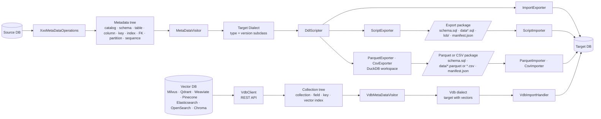

| Component | Role |
|---|---|
| `Exporter` | Reads metadata, counts rows, pages rows (ordered by primary key) and feeds an `ExportHandler` |
| `ScriptExporter` / `ImportExporter` | Facades: export to a package / import into a database |
| `ScriptImporter` | Imports an export package (validates `manifest.json`, runs files in order, restores LOBs) |
| `ParquetExporter` / `ParquetImporter` | Parquet packages and Parquet files of other tools, written and read by an embedded DuckDB workspace |
| `CsvExporter` / `CsvImporter` | CSV packages (column types in `manifest.json`) and CSV files of other tools, through the same DuckDB workspace |
| `ManualTransaction` | Runs an import in one transaction which the user commits or rolls back. DDL which would commit the rows (MySQL, MariaDB, Oracle, H2) waits for the commit |
| `AbstractFileImporter` | Picks the importer of a package by the data format in its `manifest.json` |
| `TableQuery` | Columns, WHERE, GROUP BY and ORDER BY of the data viewer, used by exports per table |
| `Dialect` + `impexp.db.*` | Per-database SQL generation. Old versions are subclasses |
| `MetaDataOperations` + `impexp.db.*` | Per-database metadata fixes (comments, identity, generated columns, partitions, sequences) |
| `VdbClient` + `vdb.client.*` | REST clients of the vector databases: collections as tables, records read page by page, conditions, native filters and nearest neighbor searches |
| `VdbExporter` + `vdb.dialect.*` | Pipeline of the vector databases, its own line next to the JDBC one: a visitor of the collection tree, `VdbDdlScripter` and `VdbImportHandler` write into the target with vectors |
| `face.*` | JavaFX UI (AtlantaFX themes, Ikonli icons) |

---

## Requirements

Only **Java 17+** is needed to run SqlJam. JavaFX and all JDBC drivers are inside the runnable jar. Building from source needs no Maven installation either, the Maven Wrapper (`./mvnw`) is included.

| Platform | Runnable jar | Launcher | Supported |
|---|---|---|:---:|
| Windows 10 / 11 (x64) | `sqljam-<version>-win.jar` | `sqljam.bat` | ✅ |
| macOS Apple Silicon | `sqljam-<version>-mac-aarch64.jar` | `sqljam.sh` | ✅ |
| macOS Intel | `sqljam-<version>-mac.jar` | `sqljam.sh` | ✅ |
| Linux x64 (GTK 3) | `sqljam-<version>-linux.jar` | `sqljam.sh` | ✅ |

| Database | Tested on | Supported from | Vectors |
|---|---|---|---|
| MySQL | 9.7 | 5.5 (`MySQL55/56/57Dialect`) | `VECTOR` from 9.0 |
| PostgreSQL | 17 | 9.x (`PostgreSQL9/10Dialect`) | pgvector 0.4 `vector` and IVFFlat, HNSW from 0.5, `halfvec` and `sparsevec` from 0.7 |
| Oracle | 26ai Free | 11g (`Oracle11g/12cDialect`) | `VECTOR` from 23ai, sparse from 23.7, HNSW with vector memory, IVF |
| SQL Server | 2025 | 2008 (`SQLServer2008Dialect`) | `VECTOR` from 2025, `float16` too |
| Db2 for Linux, UNIX and Windows | 12.1.5 | 11.1 | `VECTOR` and vector indexes from 12.1.2 |
| MariaDB | 11.8 | 10.3 | `VECTOR` and `VECTOR INDEX` from 11.7 |
| H2 | 2.3 | 2.x | as text |
| SQLite | 3.46 | 3.x | as text |
| Microsoft Access (`.accdb`, `.mdb`) | 2016 | 2000 | as text |
| DuckDB (OLAP) | 1.5 | 1.x | `FLOAT[n]` |
| ClickHouse (OLAP) | 25.8 | 24.x | `Array(Float32)`, `vector_similarity` indexes |

| Vector database (source only) | Tested on | Supported from | Read by |
|---|---|---|---|
| Milvus | 3.0 | 2.4 | REST API v2, dense, 16-bit, int8, binary and sparse vectors |
| Qdrant | 1.19 | 1.10 | scroll, named, sparse and multivectors |
| Weaviate | 1.39 | 1.24 | objects cursor and GraphQL, named vectors and tenants |
| Pinecone and Pinecone Local | API 2025-01 | API 2025-01 | list and fetch, namespaces, dense and sparse values |
| Elasticsearch | 8.19 | 8.0 | point in time, `dense_vector` |
| OpenSearch | 2.19 | 2.4 | point in time, `knn_vector` |
| Chroma | 1.5 | 1.0 | REST API v2, tenants and databases |

Collections of vector databases go into the databases above which have vectors, never the other way round. Vector types and indexes are detected on the target before they are used, by a probe of each feature, so an older server, a missing extension or a setting which is turned off keeps the vectors as text.

All JDBC drivers are bundled, no extra downloads.

---

## Quick Start

```bash
git clone git@github.com:paganini2008/sqljam.git
cd sqljam
./mvnw -DskipTests package       # Windows: mvnw.cmd -DskipTests package, output goes to bin/
bin/sqljam.sh                    # Windows: bin\sqljam.bat, or double click the jar of your platform
```

```text
bin/
├── sqljam-1.0.0-SNAPSHOT-win.jar           # runnable jar of each platform,
├── sqljam-1.0.0-SNAPSHOT-mac-aarch64.jar   # JavaFX and all JDBC drivers inside
├── sqljam-1.0.0-SNAPSHOT-mac.jar
├── sqljam-1.0.0-SNAPSHOT-linux.jar
├── sqljam.sh / sqljam.bat                  # launchers, pick the jar of the platform
├── sqljam.properties                       # configuration, edit and restart
├── sqljam.vmoptions                        # JVM options, one per line
├── sqljam.png                              # Dock icon of macOS
├── sqljam-sql.mp4 / sqljam-vectors.mp4 / sqljam-sync.mp4   # tutorial videos of about 2 minutes each
├── sqljam-1.0.0-SNAPSHOT-sources.jar
└── sqljam-1.0.0-SNAPSHOT-javadoc.jar
```

Keep `sqljam.properties` and `sqljam.vmoptions` next to the runnable jar. Copy the folder anywhere and SqlJam still finds them, even when started by double click.

SqlJam starts with a splash screen while it loads the configuration, the data sources and the JDBC drivers:

<p align="center"></p>

1. SqlJam opens its main window with the data sources in the tree, where it was closed, and connects again the data sources which were connected then. Expand a data source to connect it. **+** on the toolbar creates one: choose its category first (relational, OLAP or vector databases), the types and the fields follow it. **Connect through SSH tunnel** reaches a database behind a bastion host. A password which is not saved is asked when the data source is connected, and asked again when the database refuses it. The first start brings an **Example Shop (H2)** data source with a few e-commerce tables to try everything right away. **Help → Restore Example Database** brings it back at any time.
2. Right-click a database or schema → **Export…**
3. Pick tables, choose **SQL scripts**, **Parquet** or **CSV** (folder) or **Database** (another data source, or a new one from the **+** button next to it), press **Start**. An import into a database runs in one transaction or commits every N rows (N is typed next to it), check **Skip rows with errors** to go on after bad rows and **Confirm before commit** to review it first, and choose **Update or insert by key** or **Skip existing by key** for rows which exist already.
4. Open a table, narrow its rows on the **Data** tab with columns, WHERE, GROUP BY and ORDER BY, then **Export…** just those rows. A header sorts the rows of the page, a double click shows a whole value and **Copy Rows As** copies the selected rows. **Info** on the toolbar or a right-click shows the overview and the health of the data source.
5. **SQL Query** on the toolbar or a right-click opens an editor for the data source. **Ctrl+Enter** (**⌘+Enter** on macOS) runs the statement at the caret, **Ctrl+Shift+Enter** runs them all, then **Export…** sends all rows of the query through the same exits.
6. Create a data source of the **Vector databases** category for Milvus, Qdrant, Weaviate, Pinecone, Elasticsearch, OpenSearch or Chroma, with an API key, a user and password or neither, as the database asks. Expand it in the tree to its databases, collections and partitions (tenants of Weaviate, namespaces of Pinecone), open a collection to see its fields and its records page by page, narrowed by conditions, a native filter or a nearest neighbor search. **Import…** on the collection tab, a right-click or **File → Import from Vector Database…** opens the wizard which imports the checked collections into a data source with vectors. Only such data sources are offered as targets.
7. Right-click a connected data source → **Disconnect** when you are done, its table tabs close with it. **Exit** sits at the right end of the toolbar. **Help → About SqlJam** shows the version, the home page, the repository and the author, and the GitHub icon at the bottom right opens the repository.

Three tutorial videos of about 2 minutes each walk through SqlJam:

| Video | Shows |
|---|---|
| [SQL databases](docs/assets/sqljam-sql.mp4) | Query rows of the example database, export them into files, import the package into PostgreSQL, query with the SQL editor and copy the tables straight into SQL Server |
| [Vector databases](docs/assets/sqljam-vectors.mp4) | Browse a Qdrant collection page by page, narrow it by conditions and nearest neighbors, import it into PostgreSQL and open a tenant of Weaviate |
| [Scheduled sync and reports](docs/assets/sqljam-sync.mp4) | Create a sync task of the shop into PostgreSQL, copy all rows, then only the changed ones, read the reports and copy the command line of the task |

| Data source | Export wizard | Progress |
|---|---|---|
| 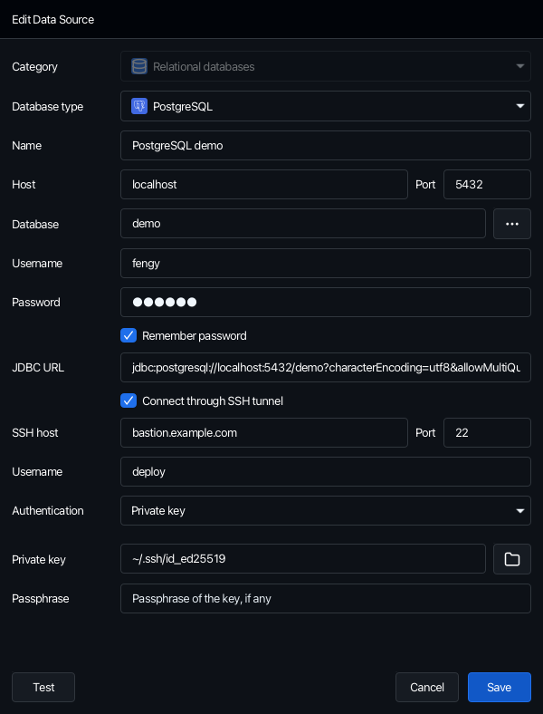 |  |  |

| Data query | Package viewer | Parquet files |
|---|---|---|
|  |  |  |

| SQL query | Package import | Light theme |
|---|---|---|
|  |  |  |

| Vector database collection | Vector database import | Database info |
|---|---|---|
| 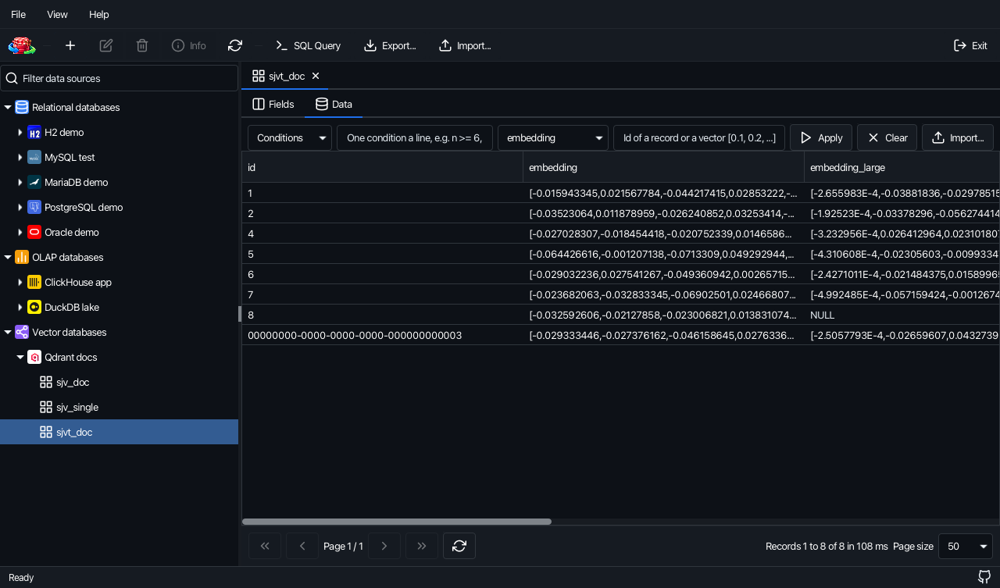 | 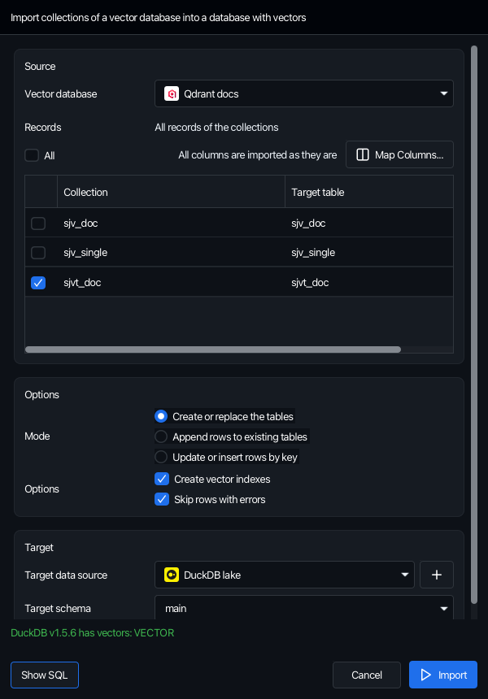 | 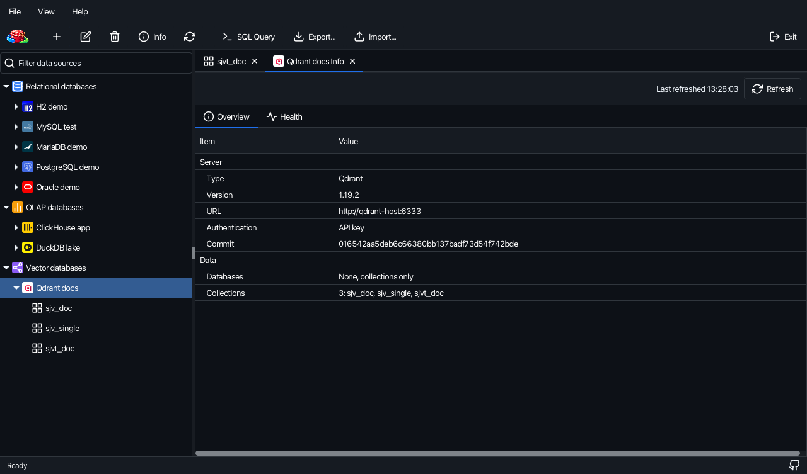 |

| Migration report | Import history | Sync tasks |
|---|---|---|
| 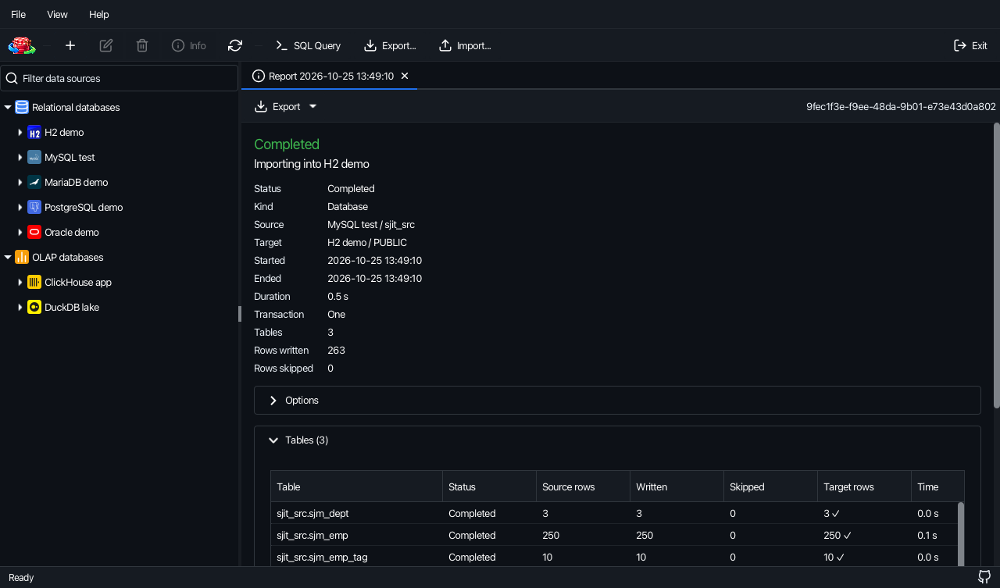 | 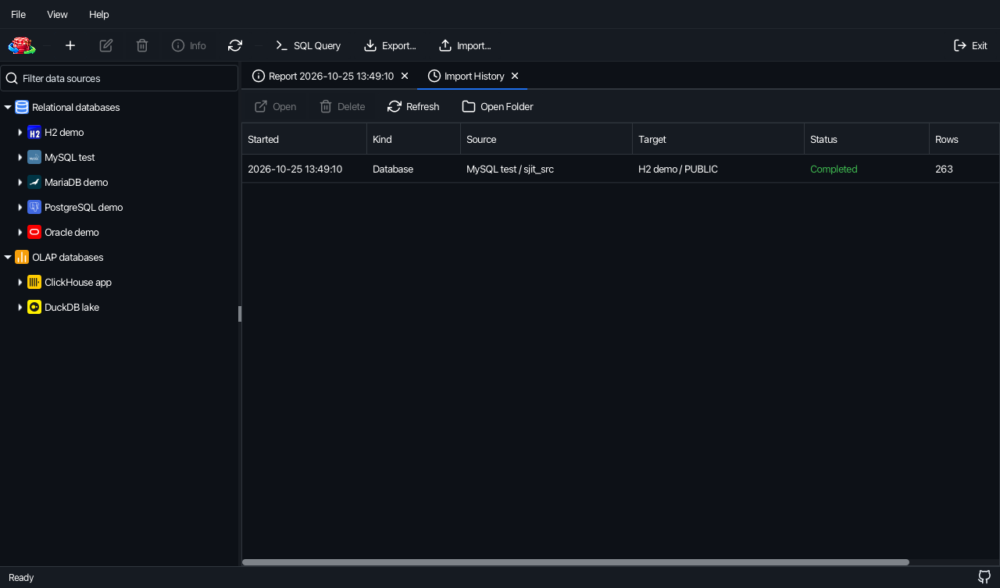 | 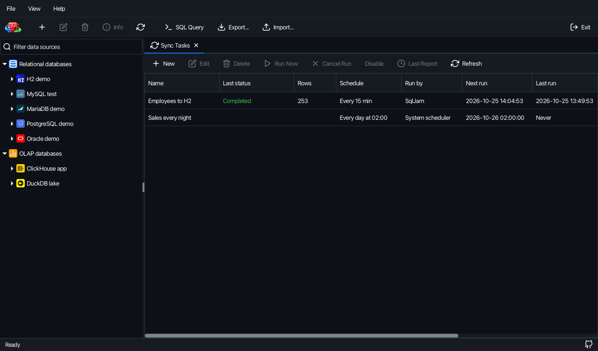 |

| Dashboard | Column mapping | Feature map |
|---|---|---|
| 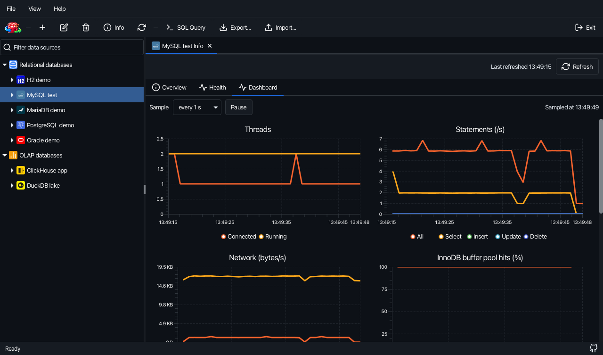 | 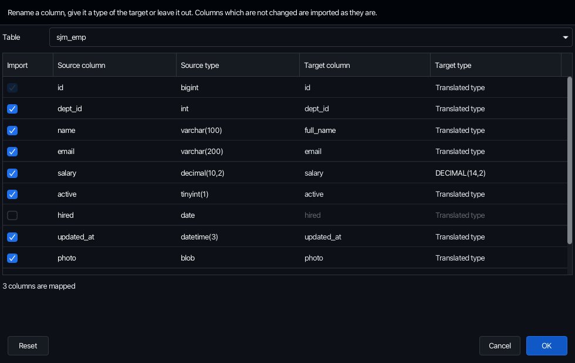 | 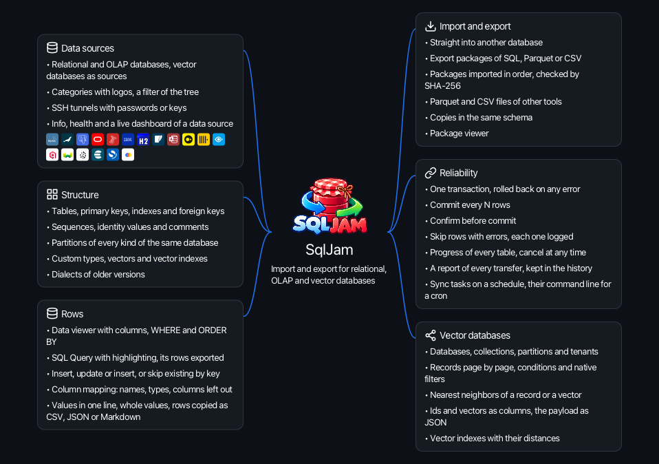 |

Expected export package:

```text
export/
├── schema.sql            # tables, sequences, indexes, comments
├── data.sql              # rows (data_2.sql, data_3.sql … when > 10 MB)
├── lob/
│   └── document/
│       ├── 000001_content.clob
│       └── 000001_attachment.blob
├── lob-manifest.json     # LOB files → table / primary key / column
├── constraints.sql       # foreign keys, applied after data
└── manifest.json         # source, target, options, files (sha256), row counts
```

A Parquet package has the same layout with `data/<table>.parquet` instead of SQL data and LOB files, a CSV package with `data/<table>.csv` and a header row. LOB values stay inside the Parquet or CSV columns, `manifest.json` records `"dataFormat": "PARQUET"` or `"CSV"` (with the type of every CSV column), so an import picks the right importer by itself and reads the values back exactly.

---

## Examples

### 1. Export tables as an export package

**Input**: MySQL database `shop`, target dialect PostgreSQL 16, one file per table.

```java
ScriptExporter exporter = new ScriptExporter(new File("export"), DataFileStrategy.FILE_PER_TABLE,
        10 * 1024 * 1024);
Exporter.ExportConfiguration config = exporter.getConfiguration();
config.setDbType(DbType.MYSQL);
config.setUrl(DbType.MYSQL.getUrl("localhost", 3306, "shop"));
config.setUsername("root");
config.setPassword("secret");
config.setIncludedCatalogNames(new String[]{"shop"});
config.setIdReused(true);                      // keep identity values
exporter.setTargetDbType(DbType.POSTGRESQL);   // generate PostgreSQL sql
exporter.setTargetSchemaName("public");
exporter.exportDdlAndData();

// The same tables as a Parquet package: data/orders.parquet ...
ParquetExporter parquet = new ParquetExporter(new File("export-parquet"));
// parquet.getConfiguration() is configured like the configuration above
parquet.setTargetDbType(DbType.POSTGRESQL);    // schema.sql and constraints.sql for PostgreSQL
parquet.setCompression("ZSTD");
parquet.exportDdlAndData();

// The same tables as a CSV package: data/orders.csv, data/orders_2.csv ...
CsvExporter csv = new CsvExporter(new File("export-csv"));
csv.setDelimiter(";");
csv.setMaxFileSize(10 * 1024 * 1024);
csv.exportDdlAndData();
```

**Output**: `export/schema.sql`, `export/data/orders.sql`, `export/data/orders_2.sql`, `export/lob/…`, `export/manifest.json`:

```sql
CREATE TABLE IF NOT EXISTS public.orders
(
    id                            bigserial                      NOT NULL,
    total                         numeric(12, 2)                 DEFAULT 0.00,
    paid                          boolean                        DEFAULT true,
    CONSTRAINT orders_pkey PRIMARY KEY (id)
);
```

### 2. Copy tables into another database

**Input**: Oracle 11g schema `HR` → SQL Server `demo.hr` (created if missing).

```java
ImportExporter importer = new ImportExporter();
Exporter.ExportConfiguration source = importer.getExportConfiguration();
source.setDbType(DbType.ORACLE);
source.setUrl(DbType.ORACLE.getUrl("ora-host", 1521, "ORCL"));
source.setUsername("hr");
source.setPassword("secret");
source.setIncludedSchemaNames(new String[]{"HR"});
source.setIdReused(true);

ImportExportHandler.ImportConfiguration target = importer.getImportConfiguration();
target.setDbType(DbType.SQLSERVER);
target.setUrl(DbType.SQLSERVER.getUrl("mssql-host", 1433, "demo"));
target.setUsername("sa");
target.setPassword("secret");
target.setTargetSchemaName("hr");            // created automatically
importer.setExportListener(new ExportListener() {
    @Override
    public void onProgress(long processed, long total) {
        System.out.printf("%d%%%n", processed * 100 / Math.max(total, 1));
    }
});
importer.exportDdlAndData();
```

**Output**: `0% … 100%`. Tables, keys, indexes, comments and sequences in `demo.hr`. Identity columns continue from the imported max value.

Rows of a query and copies in the same schema use the same API:

```java
// Only some columns and rows of EMPLOYEES, the target table is created with these columns
source.getTableQueries().put("EMPLOYEES", new TableQuery(List.of("EMPLOYEE_ID", "NAME", "SALARY"),
        "SALARY > 1000", null, "SALARY DESC"));
// Copies next to the originals: EMPLOYEES_COPY, keys and indexes get their own names
target.setTableNamePattern("{table}_copy");
```

A collection of a vector database goes into a target with vectors through the vdb pipeline:

```java
try (VdbClient client = VdbType.QDRANT.createClient(new VdbSource(VdbType.QDRANT, "http://qdrant-host:6333"))) {
    VdbExportConfiguration configuration = new VdbExportConfiguration();
    configuration.setTargetSchema("public");
    configuration.addCollection("docs", "docs");          // collection → table
    configuration.setQuery(VdbQuery.all().where("lang = 'en'"));
    configuration.setTableRecreated(true);
    VdbExportResult result = new VdbExporter(client, pgDataSource, configuration).export();
}
```

**Output**: table `public.docs` with `id`, `embedding vector(1024)`, a column of each payload field and `payload jsonb`, an HNSW index of the cosine distance of the collection, and the rows of `lang = 'en'`.

### 3. Import an export package

```java
try (Connection connection = DriverManager.getConnection(
        "jdbc:postgresql://localhost:5432/demo", "postgres", "secret")) {
    ScriptImporter importer = new ScriptImporter(connection, DbType.POSTGRESQL);
    importer.importDirectory(new File("export"));
    System.out.println(importer.getExecutedCount() + " statements, " + importer.getLobCount() + " LOBs");
}
```

**Output**: `ScriptImporter` refuses packages whose status is not `COMPLETED`, whose target type differs, or whose files fail the SHA-256 check. `AbstractFileImporter.forDirectory(dir, connection, dbType)` returns the importer of the package (SQL, Parquet or CSV), and files of other tools are loaded by `ParquetImporter` or `CsvImporter`. A `ManualTransaction` keeps the import open until you commit or roll back:

```java
ParquetImporter importer = new ParquetImporter(connection, DbType.POSTGRESQL);
long rows = importer.importFiles(List.of(new File("sales-2024.parquet")), "sales", ParquetImporter.Mode.CREATE);

try (ManualTransaction transaction = new ManualTransaction(connection, DbType.POSTGRESQL.isTransactionalDdl())) {
    AbstractFileImporter packageImporter = AbstractFileImporter.forDirectory(dir, transaction.getConnection(),
            DbType.POSTGRESQL);
    packageImporter.importDirectory(dir);
    transaction.commit();                       // or transaction.rollback()
}
```

### 4. Type translation (cross-database)

| Source column | → PostgreSQL | → Oracle | → SQL Server | → MySQL |
|---|---|---|---|---|
| MySQL `bigint unsigned` | `numeric(20, 0)` | `NUMBER(20,0)` | `decimal(20,0)` | same |
| MySQL `tinyint(1)` | `boolean` | `NUMBER(1)` | `bit` | same |
| PostgreSQL `jsonb` | same | `CLOB` | `nvarchar(max)` | `json` |
| PostgreSQL `uuid` | same | `VARCHAR2(36)` | `uniqueidentifier` | `char(36)` |
| Oracle `NUMBER(9)` / `NUMBER(19)` | `int4` / `int8` | same | `int` / `bigint` | `int` / `bigint` |
| SQL Server `datetime2(7)` | `timestamp` (µs) | `TIMESTAMP(7)` | same | `datetime(6)` |
| SQL Server `tinyint` (0 to 255) | `int2` | `NUMBER(5)` | same | `smallint` |
| Db2 `DECFLOAT(34)` | `numeric` | `NUMBER` | `decimal(38,10)` | `decimal(65,30)` |
| Db2 `GRAPHIC(10)` | `char(10)` | `CHAR(10 CHAR)` | `nchar(10)` | `char(10)` |
| Db2 `CHAR(4) FOR BIT DATA` | `bytea` | `RAW(4)` | `binary(4)` | `binary(4)` |
| Db2 `XML` | `xml` | `CLOB` | `xml` | `longtext` |
| PostgreSQL enum / domain | same (type created in the target schema) | `VARCHAR2` / base type | `varchar` / base type | `varchar` / base type |
| MySQL / Oracle / SQL Server `VECTOR(1024)` | `vector(1024)` | `VECTOR(1024, FLOAT32)` | `VECTOR(1024)` | `VECTOR(1024)` |
| PostgreSQL `halfvec(2560)` / `sparsevec(8)` | same | `VECTOR(2560, FLOAT32)` / `VECTOR(8, FLOAT32, SPARSE)` | `VECTOR(2560, float16)` / `nvarchar(max)` | `VECTOR(2560)` / `longtext` |
| pgvector HNSW index, cosine, `m = 16` | same | HNSW index, cosine, `NEIGHBORS 16` (IVF without vector memory) | vectors only | vectors only |
| ClickHouse `Nullable(String)` / `Array(T)` | `text` | `CLOB` | `nvarchar(max)` | `longtext` |
| DuckDB `HUGEINT` / `UNION` | `numeric(38, 0)` / `text` | `NUMBER(38,0)` / `CLOB` | `decimal(38,0)` / `nvarchar(max)` | `decimal(38,0)` / `longtext` |
| Access `CURRENCY` / `YESNO` / `OLE` | `numeric(19, 4)` / `boolean` / `bytea` | `NUMBER(19,4)` / `NUMBER(1)` / `BLOB` | `decimal(19,4)` / `bit` / `varbinary(max)` | `decimal(19,4)` / `tinyint(1)` / `longblob` |

### Best practices

| Do | Why |
|---|---|
| Keep **Keep identity values** on | Foreign keys stay valid. Identities/sequences are reset to `max + 1` |
| Pick the **target version** when exporting for an older server | e.g. `11.2` generates sequences + triggers instead of identity columns |
| Use **one file per table** for large exports | Re-run or inspect a single table easily |
| Import packages with SqlJam | Manifest validation, ordered files, LOB restore and FKs last |
| Use **Parquet** for analytics and lakes | Compact columnar files any engine reads, the schema still travels in `schema.sql` |
| Use **CSV** for spreadsheets and text tools | Opens anywhere, and SqlJam still restores the exact types from `manifest.json` |
| Keep **one transaction** for imports | An error rolls back everything, **Confirm before commit** shows the log and the row counts before the commit |
| Load again with **Update or insert by key** | Kept tables are updated by their primary keys, nothing is dropped |
| Shape a report in **SQL Query** first | The first rows show the columns and values, **Export…** then reads all rows by one cursor |
| Remember the passwords of the data sources of **sync tasks** | A run on a schedule has nobody to ask, a password which is not remembered fails the run |
| Read the **migration report** after a long import | The target rows are counted again after the end, a ✗ shows a table whose rows differ from the written rows |
| Copy with a **target table name** | `{table}_copy` keeps the originals, a copy in the same schema without a new name is refused |

---

## Configuration

All settings live in `sqljam.properties`, placed next to the runnable jar in `bin/`.

| Layer (later wins) | Location |
|---|---|
| Built-in defaults | Coded in the application |
| Application file | `sqljam.properties` or `conf/sqljam.properties` next to the jar, or `-Dsqljam.app.config=/path` |
| User settings saved by the UI | `~/.sqljam/sqljam.properties`, or `-Dsqljam.config=/path` |

| Property | Default | Description |
|---|---|---|
| `sqljam.home` | `${user.home}/.sqljam` | Application data directory |
| `sqljam.connections.file` | `${sqljam.home}/connections.json` | Saved data sources |
| `sqljam.vdb.enabled` | `true` | Shows the **Vector databases** category, its data sources and **File → Import from Vector Database…**, `false` hides them and loads nothing of the vector databases |
| `sqljam.vdb.connections.file` | `${sqljam.home}/vdb-connections.json` | Saved vector databases, apart from the data sources |
| `sqljam.ssh.known-hosts.file` | `${sqljam.home}/ssh_known_hosts` | Host keys of the SSH servers of tunnels, trusted on first use |
| `sqljam.ui.theme` | `Primer Dark` | Primer/Nord/Cupertino Light & Dark, Dracula |
| `sqljam.ui.window.width` / `height` | `1280` / `800` | Main window size |
| `sqljam.banner.mode` | `console` | Startup banner with the version: `console`, `log` or `off` |
| `sqljam.banner.location` | | Custom banner file, `${sqljam.version}` and `${java.version}` are resolved |
| `sqljam.splash.enabled` | `true` | Splash screen with the logo while starting |
| `sqljam.splash.min-duration` | `1200` | Minimum time of the splash screen in ms, so that it does not flash |
| `sqljam.ui.data.page-size` | `200` | Rows per page in the data viewer |
| `sqljam.export.page-size` | `5000` | Rows read per page when exporting, tuned by benchmark |
| `sqljam.export.lob-page-size` | `100` | Rows per page for tables with LOB columns, keeps memory low |
| `sqljam.import.batch-size` | `1000` | INSERT statements per batch when importing a package (Oracle uses PL/SQL blocks) |
| `sqljam.export.max-file-size` | `10485760` | Max bytes of a SQL or CSV data file before it is split (0 = unlimited) |
| `sqljam.export.parquet-max-file-size` | `268435456` | Max bytes of a Parquet file before the table is split, Parquet reads best in large files |
| `sqljam.export.csv-delimiter` | `,` | Delimiter of CSV files: `,` `;` `\|` or `\t` |
| `sqljam.import.confirm-commit.reminder-minutes` | `10` | An import waiting for commit reminds you after these minutes, its transaction holds locks and log space (0 = off) |
| `sqljam.export.data-file-strategy` | `SINGLE_FILE` | `SINGLE_FILE` or `FILE_PER_TABLE` |
| `sqljam.reports.dir` | `~/.sqljam/reports` | Folder of the migration reports, one JSON file a report |
| `sqljam.reports.keep` | `200` | Reports kept in the history, the oldest are deleted beyond it |
| `sqljam.sync.file` | `~/.sqljam/sync-tasks.json` | Sync tasks with their schedules and watermarks |
| `sqljam.sync.enabled` | `true` | The scheduler of SqlJam runs the sync tasks while it is open |
| `sqljam.sync.tick-seconds` | `30` | How often the scheduler of SqlJam looks for tasks which are due |
| `sqljam.sync.retry-delay-seconds` | `30` | First delay before a run after an error of the connection, it doubles with each attempt |
| `sqljam.export.lob-separated` | `true` | Write LOBs as files |
| `sqljam.pool.maximum-size` | `10` | HikariCP max pool size |
| `sqljam.pool.minimum-idle` | `1` | HikariCP min idle connections |
| `sqljam.pool.connection-timeout` | `30000` | ms |
| `sqljam.pool.idle-timeout` | `300000` | ms |
| `sqljam.pool.max-lifetime` | `1800000` | ms |

JVM options live in `sqljam.vmoptions` next to the runnable jar, one option per line. The launchers pass them to Java, and a jar started by double click restarts itself with them. `JAVA_OPTS` adds more and wins.

```text
# sqljam.vmoptions (defaults)
-Xms256m
-Xmx2g
-XX:+UseG1GC
-Dfile.encoding=UTF-8
```

Sync tasks run from the command line too (`sqljam.bat` on Windows). SqlJam never changes the scheduler of your system, to run tasks when SqlJam is closed you put the command into it yourself:

| Command | Does |
|---|---|
| `sqljam.sh sync --list` | Lists the tasks with their schedules, next and last runs |
| `sqljam.sh sync --task NAME` | Runs a task now, by its name or id |
| `sqljam.sh sync --task NAME --if-due` | Runs it only when it is due |
| `sqljam.sh sync --due` | Runs every task which is due, one line of cron for all of them |

The exit code is `0` when the runs completed, `1` when one failed or was cancelled, `2` for a wrong command. A task never runs twice at once, in SqlJam and on the command line.

To run a sync task on a schedule of your own:

| Step | What to do |
|---|---|
| 1 | In **Transfer > Sync Tasks** select the task and press **Copy Command**, it copies the whole command line with the path of SqlJam and the id of the task |
| 2 | Remember the passwords of its data sources, a run on a schedule has nobody to ask |
| 3 | Set the task to **Run Now only** in SqlJam, so that SqlJam and your scheduler do not both run it. Or keep its schedule in SqlJam and let your scheduler call `sync --due` |
| 4 | Put the command into the scheduler of your system, see below |
| 5 | Each run leaves its report in **Transfer > Import History**, started by the command line |

```text
# crontab of macOS and Linux (crontab -e): one task every 15 minutes
*/15 * * * * /opt/sqljam/sqljam.sh sync --task "Shop to PostgreSQL" >> ~/.sqljam/sync.log 2>&1
# or every 5 minutes, each task runs when its schedule in SqlJam is due
*/5 * * * * /opt/sqljam/sqljam.sh sync --due >> ~/.sqljam/sync.log 2>&1
```

```text
:: Windows, in a console (or the same command in the Task Scheduler)
schtasks /Create /TN "SqlJam sync" /SC MINUTE /MO 15 /TR "C:\SqlJam\sqljam.bat sync --task \"Shop to PostgreSQL\""
```

Export options (UI / `ExportConfiguration`):

| Option | Default | Description |
|---|---|---|
| `tableRecreated` | `true` | Drop and recreate target tables |
| `idReused` | `false` (UI: `true`) | Copy identity values and reset sequences |
| `indexIncluded` / `foreignKeyIncluded` / `commentIncluded` / `sequenceIncluded` | `true` | Objects to copy |
| `failFast` | `true` | Stop on the first data error, `false` skips the rows with errors and reports each of them |
| `identifierCase` | `AUTO` | `AUTO`, `KEEP`, `LOWER`, `UPPER` |
| `dataFormat` / `compression` | `SQL` / `ZSTD` | `SQL`, `PARQUET` or `CSV` packages, Parquet compression `ZSTD`, `SNAPPY`, `GZIP`, `UNCOMPRESSED` |
| `csvDelimiter` | `,` | Delimiter of CSV packages |
| `writeMode` / `keyColumnNames` | `INSERT` | `UPSERT` updates the rows of the same key (the primary key or chosen columns) and inserts the others, `SKIP_EXISTING` keeps them and inserts the others |
| `CsvOptions` | comma, `"`, UTF-8 | Delimiter, quote, NULL text, header, encoding and date format of CSV files |
| `tableNamePattern` | | Target table name, `{table}` is the source name, e.g. `{table}_copy` |
| `columnMappings` | | Target name, type or no column of a source column, by table and column, e.g. `ORDERS.NOTE → REMARK TEXT`. Other columns are imported as they are |
| `tableQueries` | | Columns, WHERE and ORDER BY per table, e.g. rows narrowed in the data viewer |
| `queries` | | Free queries exported as tables, SQL by table name, e.g. the query of the SQL editor |

---

## Performance


| Scenario (200,000 rows × 6 columns) | Time | Rows/s |
|---|---|---|
| H2 → MySQL | 9.9 s | 20.2k |
| H2 → MariaDB | 7.7 s | 26.0k |
| H2 → PostgreSQL | 6.9 s | 28.8k |
| H2 → Oracle | 4.8 s | 41.6k |
| H2 → SQL Server | 13.3 s | 15.1k |
| H2 → Db2 | 10.7 s | 18.7k |
| H2 → ClickHouse | 5.4 s | 36.8k |
| H2 → DuckDB | 5.4 s | 37.2k |
| H2 → SQL package | 2.5 s | 81.0k |
| H2 → Parquet package | 5.8 s | 34.6k |
| H2 → CSV package | 5.5 s | 36.7k |
| SQL package → PostgreSQL | 10.1 s | 19.8k |
| Qdrant → PostgreSQL (20,000 points, 256-d vectors and payload) | 18.3 s | 1.1k |

Environment: Apple M2 Max, 32 GB, JDK 17. The databases run in Docker on a server of the local network (about 100 Mbit/s), H2, DuckDB and the packages are local. Default settings. Each scenario is measured by `TransferBenchmark`.

| Design choice | Benefit |
|---|---|
| Rows paged by primary key | Stable, deterministic reads on every database |
| Tables copied one by one | Predictable load on production servers |
| Packages contain plain SQL, Parquet or CSV | Readable, editable and portable, or columnar for analytics |
| Writes sized for each database | Batched inserts, rewritten into multi-row statements for PostgreSQL and MySQL, several rows a statement for DuckDB, with the same value conversions everywhere |
| Inserts of a SQL package merged on import | The package stays one readable row a line, the database receives up to 100 rows a statement |

---

## Documentation

| Topic | Link |
|---|---|
| Project site | [paganini2008.github.io/sqljam](https://paganini2008.github.io/sqljam/) |
| Blog | [docs/blogger/sqljam-en.md](docs/blogger/sqljam-en.md) |
| Developer guide | [docs/developer-guide.md](docs/developer-guide.md), the Java API for exports, imports, copies and queries |
| Change logs | [change_logs](change_logs) |
| Core API | `com.github.sqljam.impexp` (`Exporter`, `ScriptExporter`, `ImportExporter`, `ScriptImporter`, `ParquetExporter`, `ParquetImporter`, `CsvExporter`, `CsvImporter`, `ManualTransaction`) |

**FAQ**

| Question | Answer |
|---|---|
| Can I export only some rows or columns? | Yes. Narrow the rows on the **Data** tab (columns, WHERE, ORDER BY) and press **Export…**, or set `tableQueries`. A missing target table is created with the selected columns |
| Can I export the rows of my own SQL? | Yes. Write it in **SQL Query**, run it, then **Export…**. Columns of tables keep their types, the rows are read once by a cursor. In code, put the SQL into `queries` |
| Can I copy a table inside the same database? | Yes. Choose the same data source and schema as the target and a table name such as `{table}_copy` |
| How are LOBs stored in Parquet? | Inside the Parquet columns (strings and binaries), no extra LOB files |
| How exact is CSV? | Exact. NULL is an empty field, an empty string is `""`, binaries are escaped, and every column is read back with its type from `manifest.json` |
| How are rows matched when they are updated or skipped? | By the primary key, or by the columns chosen in **Key Columns**. Choose the columns of a unique index of the target table: MySQL and MariaDB match rows by their unique indexes, PostgreSQL, SQLite and DuckDB require such an index. A table without primary key and chosen columns is inserted |
| Why does Db2 refuse a wide table? | Rows wider than a 4K page need a table space of larger pages. Create one once, e.g. `CREATE BUFFERPOOL BP32K PAGESIZE 32K` and `CREATE TABLESPACE TS32K PAGESIZE 32K BUFFERPOOL BP32K`, Db2 then places wide tables there by itself |
| Do names have to match in case? | No. An existing target table and its columns are matched without case, e.g. `OrderId` of the source writes the column `orderid` of PostgreSQL or `ORDERID` of Oracle |
| Which rows were skipped? | Each skipped row is in the log of the import with its key and its error. **Errors only** shows them, **Save Log** writes the whole log to a file |
| What does a roll back undo? | Everything on PostgreSQL, SQL Server, Db2, SQLite and DuckDB, tables included. MySQL, MariaDB, Oracle, H2 and Access commit DDL at once, there the created tables stay empty and keys and identity values are set after the commit |
| Can I export only the structure? | Yes. Rows are optional. Pick content **Structure** (`ExportMode.DDL`) for a package or a direct import. Tables, keys, indexes, comments, sequences and partitions are created without rows |
| Are partitioned tables kept? | Yes. The same database type creates the partitioning again with its partitions, bounds and rows: range, list, hash, key and subpartitions of MySQL and MariaDB (system time too), range, list, hash, default and nested partitions of PostgreSQL, range, list, hash, interval, automatic list, composite and reference partitions of Oracle, partition functions of SQL Server, range partitions of Db2 and partition keys of ClickHouse. Other databases get the tables with all rows. In the tree a partitioned table shows its partitioning next to its name and PostgreSQL partitions are listed under their table |
| How are vectors copied? | As vectors of the target with their dimensions: `vector(n)` of pgvector, `VECTOR(n)` of MySQL, MariaDB, SQL Server and Db2, `VECTOR(n, FLOAT32)` of Oracle, `FLOAT[n]` of DuckDB and `Array(Float32)` of ClickHouse. A vector index becomes the vector index of the target with the same distance. Vectors which the target can not keep exactly, e.g. doubles into pgvector, stay text and keep every digit |
| Can I generate scripts for an older server? | Yes, choose the target version (e.g. Oracle `11.2`, SQL Server `2008`) and a compatible dialect is used |
| Can I keep the password out of disk? | Uncheck *Remember password* in the data source, or *Save* when SqlJam asks for it. It stays in memory for the session, and so does the password or passphrase of the SSH tunnel |
| Can I rename columns or change their types? | Yes. **Map Columns…** next to the target data source renames a column, writes the type you type as it is, or leaves the column out. Keys, indexes, foreign keys and identity values follow the new names. In code, set `columnMappings` of the import configuration |
| Can I reach a database behind a bastion host? | Yes. Check **Connect through SSH tunnel** and enter the SSH server, its user and a password or a private key. The host and port of the data source are those which the SSH server reaches, e.g. `localhost:5432`. Exports, imports, queries and Info all go through the tunnel |
| Can I paste rows into a spreadsheet or a ticket? | Yes. Select rows of any data table and press **Ctrl+C** (**⌘+C** on macOS) for tab separated values, **Ctrl+Shift+C** with the headers, or right-click **Copy Rows As** CSV, TSV, JSON or Markdown |
| How do I run the tests? | `mvn verify`, integration tests use local databases and are skipped when unreachable |

---

## Contributing & License

| Step | |
|---|---|
| Issues | [github.com/paganini2008/sqljam/issues](https://github.com/paganini2008/sqljam/issues) |
| Pull requests | Fork → branch → `mvn verify` → PR |
| Code style | Match existing code: `getXxxStatement` naming, Apache license header, class header javadoc, 4-space indent, no Spring |
| New database or version | Add `XxxDialect` / `XxxMetaDataOperations` in `impexp.db`, register in `DbType`, add a fixture in `src/test/resources/<db>/` |

License: [Apache License 2.0](LICENSE).
