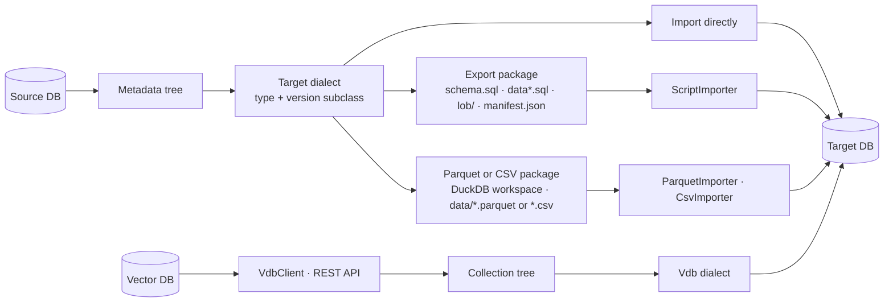

# SqlJam: Move Tables Across Databases with Schema, Data and All

<p align="center"></p>

> Tables, indexes, constraints, sequences, partitions and rows, in one go.

## 1. Overview

**SqlJam**: *Move tables across databases. Schema, data and all.*

A Java 17 + JavaFX desktop tool that copies tables between relational and OLAP databases (**MySQL, MariaDB, PostgreSQL, Oracle, SQL Server, Db2, H2, SQLite, Microsoft Access, DuckDB, ClickHouse** and more) in any direction:
**import directly** into a target database or into the same schema as copies, or save a self-describing **export package** of SQL, **Parquet** or **CSV** files and import it later. Imports into a database run in **one transaction** which an error rolls back, and rows are **inserted, updated or skipped by key**.


## 2. What Problem Does It Solve?

The hard part of a cross-database migration is not `INSERT`, it is the details: type names, identity columns, default value syntax, `bigint unsigned` overflow, timestamps shifted by time zones, BLOBs inflating scripts, and old servers rejecting new syntax. Hand-written scripts are slow and miss things.

SqlJam reads **one metadata tree** and generates SQL with a **dialect chosen by target type and version**. Export packages carry a `manifest.json`, so an import knows the target, checks completeness and verifies every file.

| Pain | SqlJam |
|---|---|
| Dialect differences | Types, identifiers, defaults, identity and literals translated by the dialect of each target |
| Old versions | Version subclasses: `Oracle11gDialect`, `PostgreSQL9Dialect`, `MySQL56Dialect`, `SQLServer2008Dialect` … |
| Missing keys & indexes | Primary keys, unique/regular indexes, foreign keys, comments, sequences, partitions of every kind (range, list, hash, interval, composite, reference, nested), shown with their partitioning in the tree |
| Huge scripts | Data files split by size: SQL and CSV at 10 MB (`orders.sql`, `orders_2.sql` …), Parquet at 256 MB (`orders.parquet`, `orders_2.parquet` …), imported part by part in order |
| LOBs | Stored as files, restored by primary key |
| Scripts without context | `manifest.json`: source, target, options, SHA-256 per file, row counts |
| Analytics needs Parquet | Parquet packages through an embedded DuckDB, Parquet files of other tools loaded into any table |
| Spreadsheets need CSV | CSV packages with your delimiter, quote, NULL text, header, encoding (UTF-8 with BOM, GBK and more) and date format, exact types kept in `manifest.json`, CSV files of other tools loaded too |
| An import went wrong | **One transaction** by default, rolled back on any error, or **commit every N rows**. **Skip rows with errors** goes on and logs each skipped row. **Confirm before commit** reviews a successful import first |
| Did every row arrive? | A **migration report** for every import and export, also when it fails or is cancelled: rows per table, skipped rows with their errors, target rows counted afterwards, created objects and where it stopped. **Import History** lists every report, Markdown, HTML or JSON on export |
| A copy has to stay up to date | **Sync Tasks** copy the changed rows by an update time or an increasing key, every N minutes or every day, run by SqlJam or by the system scheduler when it is closed, vector collections included, a report for every run |
| Rows exist already | **Update or insert by key** or **skip existing by key**: the primary key or the columns of a unique index match the rows, insert is the default |
| Warehouses apart from OLTP | DuckDB and ClickHouse data sources, grouped as OLAP databases |
| Only part of a table | Data viewer query (columns, WHERE, GROUP BY, ORDER BY) and export of the rows of the query |
| Rows of a join or a report | **SQL Query** editor with syntax highlighting, the first rows are shown and all rows of the query are exported as a table |
| Columns named or typed differently | **Map Columns…** renames a column, gives it a type of the target or leaves it out, for tables and collections. Keys, indexes and foreign keys follow the new names |
| A copy next to the original | Copies in the same schema with `{table}_copy`, keys and indexes renamed, source tables protected |
| Custom and modern types | PostgreSQL enums and domains, unions, maps, tuples and variants |
| Embeddings move with their search | Vectors of pgvector, MySQL, MariaDB, Oracle, SQL Server, Db2, DuckDB and ClickHouse keep their dimensions, vector indexes keep their distances and options |
| Embeddings live in a vector database | Milvus, Qdrant, Weaviate, Pinecone, Elasticsearch, OpenSearch and Chroma sit in the tree as **vector databases**: browse their databases, collections, partitions, tenants and namespaces, page through the records, then import collections straight into a database with vectors: ids, vectors, a column of each field and the whole payload as JSON |
| Database behind a bastion host | **SSH tunnel** per data source with a password or a private key, host keys trusted on first use, a broken tunnel opens again by itself |
| Which server, how healthy? | **Info** shows the overview and the health of a data source or a vector database, and a **Dashboard** of live charts: sessions, transactions, rows, cache, locks, network, CPU and memory |
| Long values, rows for a ticket | One line per cell, a double click shows the whole value, **Copy Rows As** CSV, TSV, JSON or Markdown |
| Many data sources | Grouped as relational, OLAP and vector databases with their logos, a **filter** above the tree |

## 3. Quick Start

```bash
git clone git@github.com:paganini2008/sqljam.git && cd sqljam
./mvnw -DskipTests package       # Windows: mvnw.cmd, output goes to bin/
bin/sqljam.sh                    # Windows: bin\sqljam.bat, or double click the jar of your platform
```

```text
bin/
├── sqljam-1.0.0-SNAPSHOT-win.jar           # runnable jar of each platform,
├── sqljam-1.0.0-SNAPSHOT-mac-aarch64.jar   # JavaFX and all JDBC drivers inside
├── sqljam-1.0.0-SNAPSHOT-mac.jar
├── sqljam-1.0.0-SNAPSHOT-linux.jar
├── sqljam.sh / sqljam.bat                  # launchers, pick the jar of the platform
├── sqljam.properties                       # configuration, edit and restart
├── sqljam.vmoptions                        # JVM options, one per line
├── sqljam.png                              # Dock icon of macOS
└── sqljam-sql.mp4 / sqljam-vectors.mp4 / sqljam-sync.mp4   # tutorial videos of about 2 minutes each
```

`sqljam.properties` and `sqljam.vmoptions` sit next to the runnable jar. Edit them and restart, no rebuild needed.

A splash screen shows the loading of the configuration, the data sources and the JDBC drivers:

<p align="center"></p>

SqlJam opens its main window like DBeaver and DataGrip, where it was closed, with the data sources in the tree, and connects again those which were connected then. A password which is not saved is asked when a data source is connected. The first start brings an **Example Shop (H2)** data source with a few e-commerce tables (categories, customers, products, orders, order_items) to try everything right away. **Help → Restore Example Database** brings it back at any time.

Right-click a data source to **Connect**, and once it is connected the same menu offers **Disconnect**, which also closes its table tabs. When an import or export needs a target data source, the **+** button next to it creates one on the spot. **Exit** sits at the right end of the toolbar. **Help → About SqlJam** shows the version, the home page, the repository and how to reach the author, and the GitHub icon at the bottom right opens the repository.

**SQL Query** on the toolbar opens an editor for the selected data source. **Ctrl+Enter** (**⌘+Enter** on macOS) runs the statement at the caret, **Ctrl+Shift+Enter** runs them all, and **Export…** sends all rows of the query to SQL, Parquet, CSV or another database:


A new data source starts with its category: relational, OLAP or vector databases, and the types and fields follow it. **Connect through SSH tunnel** reaches a database behind a bastion host with a password or a private key.

A vector database is a data source of the **Vector databases** category, with an API key, a user and password or neither. Expand it in the tree to its databases, collections and partitions (tenants of Weaviate, namespaces of Pinecone) and open a collection: its fields, and its records page by page, narrowed by conditions, a native filter or a nearest neighbor search. **Import…** opens the wizard which writes the checked collections into a data source with vectors. Only such data sources are offered as targets.

Every data table shows one line per cell. A double click or **Shift+Enter** opens the whole value with JSON indented and vectors described, a header sorts the rows of the page, and **Copy Rows As** copies the selected rows as CSV, TSV, JSON or Markdown. **Info** on the toolbar shows the server, the driver, the session and the health of the selected data source.

Three tutorial videos of about 2 minutes each walk through SqlJam: [SQL databases](https://github.com/paganini2008/sqljam/blob/master/docs/assets/sqljam-sql.mp4) (query, export into files, import into PostgreSQL, the SQL editor, a copy into SQL Server), [vector databases](https://github.com/paganini2008/sqljam/blob/master/docs/assets/sqljam-vectors.mp4) (a Qdrant collection, its import into PostgreSQL, tenants of Weaviate) and [scheduled sync and reports](https://github.com/paganini2008/sqljam/blob/master/docs/assets/sqljam-sync.mp4) (a sync task of the shop into PostgreSQL, its reports and the system scheduler).

| 1. Data source | 2. Export wizard | 3. Progress |
|---|---|---|
|  |  |  |

| 4. Data query | 5. Package viewer | 6. Parquet files |
|---|---|---|
|  |  |  |

| 7. Vector database collection | 8. Vector database import | 9. Database info |
|---|---|---|
|  |  |  |

| 10. Migration report | 11. Import history | 12. Sync tasks |
|---|---|---|
|  |  |  |

| 13. Dashboard | 14. Column mapping | 15. Feature map |
|---|---|---|
|  |  |  |

## 4. Requirements

Only **Java 17+** is needed to run SqlJam. JavaFX and the JDBC drivers are inside the runnable jar, and building needs no Maven installation thanks to the Maven Wrapper (`./mvnw`).

| Platform | Runnable jar | Launcher | Supported |
|---|---|---|:---:|
| Windows 10 / 11 (x64) | `sqljam-<version>-win.jar` | `sqljam.bat` | ✅ |
| macOS Apple Silicon | `sqljam-<version>-mac-aarch64.jar` | `sqljam.sh` | ✅ |
| macOS Intel | `sqljam-<version>-mac.jar` | `sqljam.sh` | ✅ |
| Linux x64 (GTK 3) | `sqljam-<version>-linux.jar` | `sqljam.sh` | ✅ |

| Database | Version |
|---|---|
| MySQL | 5.5 to 9.x |
| PostgreSQL | 9.x to 17 |
| Oracle | 11g to 23ai |
| SQL Server | 2008 to 2025 |
| MariaDB | 10.3 to 11.x |
| H2 / SQLite | 2.x / 3.x |
| Microsoft Access (.accdb, .mdb) | 2000 to 2019 |
| DuckDB (OLAP) | 1.x |
| ClickHouse (OLAP) | 24.x to 26.x |

| Vector database (source only) | Version |
|---|---|
| Milvus | 2.4 to 3.x |
| Qdrant | 1.10 to 1.19 |
| Weaviate | 1.24 to 1.39 |
| Pinecone and Pinecone Local | API 2025-01 |
| Elasticsearch | 8.0 to 8.19 |
| OpenSearch | 2.4 to 2.19 |
| Chroma | 1.0 to 1.5 |

All JDBC drivers are bundled in the fat jar.

## 5. How It Works




- **Read metadata once**: `XxxMetaDataOperations` completes comments, identity, generated columns, partitions and sequences per database.
- **Generate for the target**: `DbType.createDialect(major, minor)` picks the version subclass.
- **Stream rows**: count rows (percentage progress) → page by primary key → normalize values → batch insert or SQL literals.
- **Parquet and CSV**: rows pass an embedded DuckDB workspace, `COPY ... TO` writes them, `read_parquet` or `read_csv` with the column types of `manifest.json` loads them back.
- **Transactions**: an import runs in one transaction, committed when it succeeds or after your confirmation. MySQL, MariaDB, Oracle and H2 commit around DDL, so keys and identity values are set after the commit.
- **Upserts and skips**: `ON CONFLICT`, `ON DUPLICATE KEY UPDATE` or `MERGE` of each database, kept tables, indexes and keys are skipped.
- **Skipped errors**: a failed page is written row by row under savepoints, each bad row is logged with its key and the others are kept.
- **Vector databases**: a line of its own next to the JDBC one. REST clients read the collections, a visitor of the collection tree builds the tables, and `VdbImportHandler` writes the pages into the target, whose vector features are probed first.

## 6. Code Examples

### Example 1: Export as a PostgreSQL package

**Input**: MySQL database `shop`

```java
ScriptExporter exporter = new ScriptExporter(new File("export"), DataFileStrategy.FILE_PER_TABLE, 10 * 1024 * 1024);
Exporter.ExportConfiguration config = exporter.getConfiguration();
config.setDbType(DbType.MYSQL);
config.setUrl(DbType.MYSQL.getUrl("localhost", 3306, "shop"));
config.setUsername("root");
config.setPassword("secret");
config.setIdReused(true);
exporter.setTargetDbType(DbType.POSTGRESQL);
exporter.exportDdlAndData();
```

**Output**

```text
export/
├── schema.sql   ├── data/orders.sql   ├── data/orders_2.sql
├── lob/         ├── lob-manifest.json ├── constraints.sql
└── manifest.json
```

The same tables as Parquet files:

```java
ParquetExporter parquet = new ParquetExporter(new File("export-parquet"));
parquet.setTargetDbType(DbType.POSTGRESQL);
parquet.setCompression("ZSTD");
parquet.exportDdlAndData();   // schema.sql, data/orders.parquet, constraints.sql, manifest.json

CsvExporter csv = new CsvExporter(new File("export-csv"));
csv.setDelimiter(";");
csv.exportDdlAndData();       // data/orders.csv, data/orders_2.csv ...
```

### Example 2: Oracle → SQL Server directly (schema created)

```java
ImportExporter importer = new ImportExporter();
Exporter.ExportConfiguration source = importer.getExportConfiguration();
source.setDbType(DbType.ORACLE);
source.setUrl(DbType.ORACLE.getUrl("ora-host", 1521, "ORCL"));
source.setUsername("hr");
source.setPassword("secret");
source.setIncludedSchemaNames(new String[]{"HR"});
ImportExportHandler.ImportConfiguration target = importer.getImportConfiguration();
target.setDbType(DbType.SQLSERVER);
target.setUrl(DbType.SQLSERVER.getUrl("mssql-host", 1433, "demo"));
target.setUsername("sa");
target.setPassword("secret");
target.setTargetSchemaName("hr");
importer.exportDdlAndData();
```

**Output**: tables, keys, indexes, foreign keys, comments and sequences in `demo.hr`. Identities continue from the imported max value.

Rows of a query and copies in the same schema:

```java
source.getTableQueries().put("EMPLOYEES", new TableQuery(List.of("EMPLOYEE_ID", "NAME", "SALARY"),
        "SALARY > 1000", null, "SALARY DESC"));   // target table created with these columns
target.setTableNamePattern("{table}_copy");       // EMPLOYEES_COPY next to EMPLOYEES
```

| Source column | → PostgreSQL | → Oracle | → SQL Server |
|---|---|---|---|
| MySQL `bigint unsigned` | `numeric(20, 0)` | `NUMBER(20,0)` | `decimal(20,0)` |
| PostgreSQL `jsonb` | same | `CLOB` | `nvarchar(max)` |
| SQL Server `datetime2(7)` | `timestamp` | `TIMESTAMP(7)` | same |
| PostgreSQL enum / domain | same (created in the target schema) | `VARCHAR2` / base type | `varchar` / base type |
| MySQL / Oracle / SQL Server `VECTOR(1024)` | `vector(1024)` | `VECTOR(1024, FLOAT32)` | `VECTOR(1024)` |
| PostgreSQL `halfvec(2560)` / `sparsevec(8)` | same | `VECTOR(2560, FLOAT32)` / `VECTOR(8, FLOAT32, SPARSE)` | `VECTOR(2560, float16)` / `nvarchar(max)` |
| ClickHouse `Array(T)` / `Map(K, V)` | `text` | `CLOB` | `nvarchar(max)` |

A collection of a vector database goes straight into a target with vectors:

```java
try (VdbClient client = VdbType.QDRANT.createClient(new VdbSource(VdbType.QDRANT, "http://qdrant-host:6333"))) {
    VdbExportConfiguration configuration = new VdbExportConfiguration();
    configuration.setTargetSchema("public");
    configuration.addCollection("docs", "docs");
    configuration.setQuery(VdbQuery.all().where("lang = 'en'"));
    new VdbExporter(client, pgDataSource, configuration).export();
}
```

**Output**: `public.docs` with `id`, `embedding vector(1024)`, a column of each payload field and `payload jsonb`, and an HNSW index of the cosine distance of the collection.

## 7. Configuration

All settings live in `bin/sqljam.properties` next to the runnable jar. Settings changed in the UI are saved to `~/.sqljam/sqljam.properties` and win over the file.

| Property | Default | Description |
|---|---|---|
| `sqljam.export.max-file-size` | `10485760` | Max bytes of a SQL or CSV data file |
| `sqljam.export.parquet-max-file-size` | `268435456` | Max bytes of a Parquet file, Parquet reads best in large files |
| `sqljam.export.csv-delimiter` | `,` | Delimiter of CSV files |
| `sqljam.import.confirm-commit.reminder-minutes` | `10` | Reminder for an import still waiting for commit |
| `sqljam.export.data-file-strategy` | `SINGLE_FILE` | Single file or one file per table |
| `sqljam.export.lob-separated` | `true` | Write LOBs as files |
| `sqljam.export.page-size` | `5000` | Rows per page, tuned by benchmark |
| `sqljam.export.lob-page-size` | `100` | Rows per page for tables with LOB columns |
| `sqljam.banner.mode` | `console` | Startup banner with the version: console, log or off |
| `sqljam.import.batch-size` | `1000` | INSERT statements per batch when importing a package |
| `sqljam.ui.theme` | `Primer Dark` | 7 themes |
| `sqljam.pool.maximum-size` | `10` | Connection pool size |
| `sqljam.vdb.enabled` | `true` | Shows the vector databases, `false` hides them |
| `sqljam.vdb.connections.file` | `${sqljam.home}/vdb-connections.json` | Saved vector databases |
| `sqljam.ssh.known-hosts.file` | `${sqljam.home}/ssh_known_hosts` | Host keys of the SSH servers of tunnels |

## 8. Performance


| Scenario (200,000 rows × 6 columns) | Time | Rows/s |
|---|---|---|
| H2 → MySQL | 10.3 s | 19.5k |
| H2 → MariaDB | 9.5 s | 21.1k |
| H2 → PostgreSQL | 6.4 s | 31.3k |
| H2 → Oracle | 4.2 s | 47.9k |
| H2 → SQL Server | 12.0 s | 16.7k |
| H2 → Db2 | 9.3 s | 21.6k |
| H2 → ClickHouse | 4.2 s | 47.4k |
| H2 → DuckDB | 5.7 s | 35.1k |
| H2 → SQL package | 2.6 s | 76.1k |
| H2 → Parquet package | 5.7 s | 35.4k |
| H2 → CSV package | 5.8 s | 34.7k |
| SQL package → PostgreSQL | 24.3 s | 8.2k |
| Qdrant → PostgreSQL (20,000 points, 256-d vectors and payload) | 18.4 s | 1.1k |

Environment: Apple M2 Max, 32 GB, JDK 17. The databases run in Docker on a server of the local network (about 100 Mbit/s), H2, DuckDB and the packages are local. Default settings. Each scenario is measured by `TransferBenchmark`.

**Quality**: a full cross-database import matrix with every column type of every database, SQL, Parquet and CSV package round trips, commit and roll back verified on every database, copies in the same schema, old-version SQL executed on real servers, UI and boundary tests.

## 9. Design Trade-offs

- **Table-level focus**: tables, keys, indexes, constraints, sequences, partitions and comments: the objects data migration depends on.
- **Rows paged by primary key**: stable, deterministic reads on every database.
- **Tables copied one by one**: predictable load on production servers.
- **Plain SQL in packages**: readable, editable and portable. Direct import uses batched inserts for speed.
- **Version-specific SQL**: older servers get the syntax they understand instead of a lowest common denominator.
- **Parquet and CSV through DuckDB**: one embedded engine writes and reads both, no Hadoop libraries.
- **One transaction by default**: an import is all or nothing, confirm before commit when you want to look first.
- **Grouped rows are for viewing**: exports carry real table rows, a GROUP BY result is a view of them.
- **Vector databases are sources**: their collections go into a relational database with vectors, which stays the end point of every copy.
- **Copies need their own names**: a copy in the same schema takes a table name such as `{table}_copy`, so the originals are never replaced.

## 10. Summary

1. Any-to-any copies. Every cross-database pair passes automated tests.
2. Dialects are chosen by **type + version**. Old versions are subclasses.
3. Tables, indexes, constraints, sequences, partitions and comments move together.
4. Export package = SQL + LOB files + `manifest.json`. Export and import are paired.
5. Data files split by size (SQL and CSV 10 MB, Parquet 256 MB) and imported in order. LOBs stored separately.
6. Timestamps, unsigned numbers, bits, money, UUID and JSON survive the trip.
7. Pooled connections and batch inserts: 40k to 95k rows/s for direct imports.
8. A mainstream dark UI with 7 themes, percentage progress and cancel.
9. Parquet and CSV packages and files of other tools, DuckDB and ClickHouse as OLAP data sources, imports in one transaction and rows updated by key.
10. A SQL Query editor exports the rows of any query through the same exits, columns of tables keep their types.
11. Query the rows of a table, export just those rows, or copy tables inside the same schema.
12. Collections of Milvus, Qdrant, Weaviate, Pinecone, Elasticsearch, OpenSearch and Chroma go straight into a database with vectors, previewed by conditions, native filters or nearest neighbor searches.
