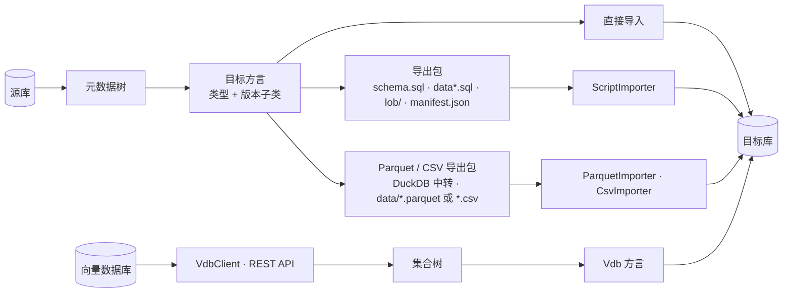

# SqlJam：跨数据库，一键搬表

<p align="center"></p>

> 结构、索引、约束、序列、分区、数据，一起搬走。

## 1. Overview

**SqlJam**：*Move tables across databases. Schema, data and all.*

一个 Java 17 + JavaFX 的桌面导入导出工具，支持关系型与 OLAP 数据库（**MySQL、MariaDB、PostgreSQL、Oracle、SQL Server、Db2、H2、SQLite、Microsoft Access、DuckDB、ClickHouse** 等）任意互导：
可以**直接导入目标库**，也可以在同一个 schema 里复制表，或者导出为带描述文件的 **SQL / Parquet / CSV 导出包**，之后再成对导入。导入目标库默认在**一个事务**里完成，出错整体回滚，数据可以**按主键更新、插入或跳过**。


## 2. 解决什么问题？

跨库迁移最麻烦的不是 `INSERT`，而是那些"细节"：类型名不同、自增实现不同、默认值语法不同、`bigint unsigned` 溢出、时间被时区平移、BLOB 写进脚本后几百 MB、老版本数据库不认新语法……手写脚本既慢又容易漏。

SqlJam 用**一棵元数据树 + 按目标库和版本选择的方言**，把这些差异集中处理掉。导出包自带 `manifest.json`，导入时能校验"导给谁、完整不完整、文件有没有被改过"。

| 痛点 | SqlJam 的做法 |
|---|---|
| 方言差异 | 按目标方言统一翻译类型 / 标识符 / 默认值 / 自增 / 字面量 |
| 老版本 | `Oracle11gDialect`、`PostgreSQL9Dialect`、`MySQL56Dialect`、`SQLServer2008Dialect` 等版本子类 |
| 丢键丢索引 | 主键、唯一/普通索引、外键、注释、序列、各类分区（范围、列表、哈希、间隔、组合、引用、多级）一起迁移，树上分区表带分区方式标签 |
| 脚本太大 | 数据文件按大小切分：SQL 与 CSV 按 10 MB 切成 `orders.sql`、`orders_2.sql`…，Parquet 按 256 MB 切成 `orders.parquet`、`orders_2.parquet`…，导入时按序号依次导入 |
| LOB 难处理 | LOB 单独存文件，按主键回填 |
| 脚本没有上下文 | `manifest.json`：源、目标、选项、文件 SHA-256、行数 |
| 分析要 Parquet | 内置 DuckDB 生成 Parquet 导出包，也能把其他工具产出的 Parquet 文件加载进任意表 |
| 表格工具要 CSV | CSV 导出包可选分隔符、引号、NULL 表示、表头、编码（Excel 用的 UTF-8 BOM、GBK 等）和日期格式，`manifest.json` 记录每列类型，导回时精确还原，也能加载其他工具的 CSV 文件 |
| 导错了怎么办 | 默认**一个事务**：出错整体回滚，也可以**每 N 行提交一次**。勾选**跳过出错的行**则继续导入，每条跳过的记录都写进日志，可筛选、可保存。勾选**提交前确认**，导入成功后先看结果再 **Commit** 或 **Roll Back** |
| 数据到底全过去了没有 | 每次导入导出都有**迁移报告**，成功、失败、取消或回滚都有：每张表的源行数、写入行数、跳过行数，结束后重新统计的目标行数和 ✓ / ✗ 核对结果，创建了哪些对象，每条跳过的行和原因，停在哪张表的第几行，以及中断的错误。**View Report** 单独一页打开，**Transfer → Import History** 列出全部历史报告，可导出 Markdown、HTML、JSON |
| 副本要一直保持最新 | **Sync Tasks** 定时同步：按更新时间列或递增主键找出上次之后变化的行，每 N 分钟或每天定点运行。首次全量，提交成功后才移动水位，连接类错误自动重试，数据类错误不重试。可以由 SqlJam 在打开时运行，也可以登记到**系统调度器**（crontab、Windows 任务计划），SqlJam 关着也照跑。向量库集合同样可以同步，每次同步都有迁移报告 |
| 目标已有部分数据 | **按主键更新或插入**：主键（或自选的唯一索引列）相同的行更新，其余插入。**按主键跳过已存在的行**：已有的行保持不变，只插入新行。默认是插入 |
| 数仓和业务库割裂 | DuckDB、ClickHouse 作为 OLAP 数据源，和关系型数据库分组展示 |
| 只要表的一部分 | 数据页查询（列、WHERE、GROUP BY、ORDER BY），只导出查询结果的行 |
| 数据来自多表关联或报表 | **SQL Query** 查询器带语法高亮，先看前几行，再把查询的全部结果当作一张表导出 |
| 目标列的名字或类型不一样 | **Map Columns…** 逐列改目标列名、指定目标类型或不导入某列，表和向量库集合都可以。键、索引、外键跟着新名字走，没改的列原样导入 |
| 原地复制一份表 | 同一 schema 内按 `{table}_copy` 复制，键、索引、约束自动改名，原表受保护 |
| 自定义和新型类型 | PostgreSQL 枚举与域、联合、Map、Tuple、Variant |
| 向量检索跟着数据走 | pgvector、MySQL、MariaDB、Oracle、SQL Server、Db2、DuckDB、ClickHouse 的向量保留维度，向量索引保留距离和参数 |
| 向量存在向量数据库里 | Milvus、Qdrant、Weaviate、Pinecone、Elasticsearch、OpenSearch、Chroma 作为**向量数据库**出现在连接树中：浏览数据库、集合、分区、租户和命名空间，分页查看记录，再把集合直接写进支持向量的数据库：id、向量、每个字段各成一列，完整 payload 保存为 JSON |
| 数据库在跳板机后面 | 每个数据源可配 **SSH 隧道**，用密码或私钥认证，主机密钥首次信任后记住，隧道断开后自动重连 |
| 连的是哪台服务器，状态如何 | **信息页**显示数据源或向量数据库的概览和健康状况。**Dashboard** 子页画最近 5 分钟的实时曲线，每 1 到 30 秒采样一次：会话、事务、语句、行数、缓存命中、锁等待、网络、CPU、内存和库大小，取自各数据库自己的统计视图。嵌入式数据库跑在 SqlJam 进程里，显示 SqlJam 的 CPU 和内存。服务器不提供的指标会列出原因 |
| 长内容，要把几行贴进工单 | 单元格只显示一行，双击查看完整内容，**Copy Rows As** 复制为 CSV、TSV、JSON 或 Markdown |
| 数据源太多 | 按关系型、OLAP、向量数据库分组并显示各自的图标，树上方的**过滤框**按名称或类型查找 |

## 3. Quick Start

```bash
git clone git@github.com:paganini2008/sqljam.git && cd sqljam
./mvnw -DskipTests package       # Windows 用 mvnw.cmd，输出到 bin/
bin/sqljam.sh                    # Windows 用 bin\sqljam.bat，也可以直接双击本平台的 jar
```

```text
bin/
├── sqljam-1.0.0-SNAPSHOT-win.jar           # 每个平台一个可运行 jar，
├── sqljam-1.0.0-SNAPSHOT-mac-aarch64.jar   # 内置 JavaFX 和全部 JDBC 驱动
├── sqljam-1.0.0-SNAPSHOT-mac.jar
├── sqljam-1.0.0-SNAPSHOT-linux.jar
├── sqljam.sh / sqljam.bat                  # 启动脚本，自动选择本平台的 jar
├── sqljam.properties                       # 外置配置，改完重启即可
├── sqljam.vmoptions                        # JVM 参数，一行一个
├── sqljam.png                              # macOS 程序坞图标
└── sqljam-sql.mp4 / sqljam-vectors.mp4 / sqljam-sync.mp4   # 三段教学视频，每段约 2 分钟
```

`sqljam.properties`、`sqljam.vmoptions` 和可运行 jar 放在一起。整个目录拷到任何地方都能用，双击启动也能找到配置。

启动时显示启动画面，同时加载配置、数据源和 JDBC 驱动：

<p align="center"></p>

启动后和 DBeaver、DataGrip 一样直接进入主界面，窗口在上次关闭的位置，树中列出所有数据源，上次连着的数据源会自动重新连接。没有保存密码的数据源在连接时询问密码。首次启动会自带一个 **Example Shop (H2)** 示例数据源，包含几张电商表（categories、customers、products、orders、order_items），装好就能直接体验。删掉了也没关系，菜单 **Help → Restore Example Database** 随时可以恢复。

右键数据源选 **Connect**，连上之后同一个菜单变成 **Disconnect**，断开时它的表页签一起关闭。导入导出选目标数据源时，旁边的 **+** 按钮可以当场新建一个。工具栏最右边是 **Exit**。**Help → About SqlJam** 里有版本、主页、仓库地址和作者联系方式，右下角的 GitHub 图标点一下直接打开仓库。

工具栏的 **SQL Query** 为选中的数据源打开查询器。**Ctrl+Enter**（macOS 上是 **⌘+Enter**）执行光标所在的语句，**Ctrl+Shift+Enter** 执行全部，**Export…** 把查询的全部结果导出为 SQL、Parquet、CSV 或导入另一个数据库：


新建数据源先选类别：关系型、OLAP 或向量数据库，类型和字段随类别变化。勾选 **Connect through SSH tunnel** 可以经跳板机连接数据库，用密码或私钥认证。

向量数据库是**向量数据库**类别的数据源，按各库的要求填 API key、用户和密码，或者都不填。在树中展开到数据库、集合和分区（Weaviate 的租户、Pinecone 的命名空间），打开集合就能看到字段和分页的记录，可以按条件、原生过滤或最近邻搜索筛选。**Import…** 打开导入向导，把勾选的集合写进支持向量的数据源。目标列表只显示支持向量的数据源。

所有数据表格每格只显示一行，双击或 **Shift+Enter** 查看完整内容（JSON 自动缩进，向量显示维度），点表头对本页排序，**Copy Rows As** 把选中的行复制为 CSV、TSV、JSON 或 Markdown。工具栏的 **Info** 显示所选数据源的服务器、驱动、会话和健康状况。

三段教学视频，每段约 2 分钟：[SQL 数据库](https://github.com/paganini2008/sqljam/blob/master/docs/assets/sqljam-sql.mp4)（筛选行、导出到文件、导出包导入 PostgreSQL、SQL 查询器、直接复制到 SQL Server），[向量数据库](https://github.com/paganini2008/sqljam/blob/master/docs/assets/sqljam-vectors.mp4)（浏览 Qdrant 集合、导入 PostgreSQL、Weaviate 租户），[定时同步与迁移报告](https://github.com/paganini2008/sqljam/blob/master/docs/assets/sqljam-sync.mp4)（示例库同步到 PostgreSQL、首次全量和增量、查看报告、交给系统调度器）。

| 1. 数据源 | 2. 导出向导 | 3. 进度 |
|---|---|---|
|  |  |  |

| 4. 数据查询 | 5. 导出包浏览 | 6. Parquet 文件 |
|---|---|---|
|  |  |  |

| 7. 向量数据库集合 | 8. 向量数据库导入 | 9. 数据库信息 |
|---|---|---|
|  |  |  |

| 10. 迁移报告 | 11. 导入历史 | 12. 同步任务 |
|---|---|---|
|  |  |  |

| 13. 监控仪表盘 | 14. 列映射 | 15. 功能图谱 |
|---|---|---|
|  |  |  |

## 4. Requirements

运行只需要 **Java 17+**。JavaFX 和 JDBC 驱动都打进了可运行 jar，从源码构建也不需要安装 Maven，项目自带 Maven Wrapper（`./mvnw`）。

| 平台 | 可运行 jar | 启动方式 | 支持 |
|---|---|---|:---:|
| Windows 10 / 11（x64） | `sqljam-<版本>-win.jar` | `sqljam.bat` | ✅ |
| macOS Apple Silicon | `sqljam-<版本>-mac-aarch64.jar` | `sqljam.sh` | ✅ |
| macOS Intel | `sqljam-<版本>-mac.jar` | `sqljam.sh` | ✅ |
| Linux x64（GTK 3） | `sqljam-<版本>-linux.jar` | `sqljam.sh` | ✅ |

| 数据库 | 版本 |
|---|---|
| MySQL | 5.5 ~ 9.x |
| PostgreSQL | 9.x ~ 17 |
| Oracle | 11g ~ 23ai |
| SQL Server | 2008 ~ 2025 |
| MariaDB | 10.3 ~ 11.x |
| H2 / SQLite | 2.x / 3.x |
| Microsoft Access（.accdb、.mdb） | 2000 ~ 2019 |
| DuckDB（OLAP） | 1.x |
| ClickHouse（OLAP） | 24.x ~ 26.x |

| 向量数据库（仅作源） | 版本 |
|---|---|
| Milvus | 2.4 ~ 3.x |
| Qdrant | 1.10 ~ 1.19 |
| Weaviate | 1.24 ~ 1.39 |
| Pinecone、Pinecone Local | API 2025-01 |
| Elasticsearch | 8.0 ~ 8.19 |
| OpenSearch | 2.4 ~ 2.19 |
| Chroma | 1.0 ~ 1.5 |

JDBC 驱动全部打进 fat jar，无需额外下载。

## 5. How It Works




- **读一次元数据**：`XxxMetaDataOperations` 按库补全注释、自增、生成列、分区、序列。
- **按目标生成 SQL**：`DbType.createDialect(major, minor)` 选出版本子类。
- **数据流**：先统计行数（百分比进度）→ 按主键分页读取 → 值归一化 → 批量写入或生成字面量。
- **Parquet 与 CSV**：数据经过内置的 DuckDB 中转，`COPY ... TO` 写出，`read_parquet` 或按 `manifest.json` 中列类型的 `read_csv` 读回。
- **事务**：导入在一个事务里完成，成功自动提交或经你确认后提交。MySQL、MariaDB、Oracle、H2 执行 DDL 会隐式提交，外键和自增值等语句延后到提交之后执行。
- **按主键更新或跳过**：使用各库的 `ON CONFLICT`、`ON DUPLICATE KEY UPDATE` 或 `MERGE`，已存在的表、索引、键自动跳过。
- **跳过出错的行**：出错的一页在 savepoint 保护下逐行重写，每条坏行连同主键和错误写进日志，其余行照常保留。
- **向量数据库**：独立于 JDBC 主线的一条流水线。REST 客户端读取集合，访问者遍历集合树生成建表语句，`VdbImportHandler` 分页写入目标库，写入前先探测目标库的向量特性。

## 6. Code Examples

### Example 1：导出为 PostgreSQL 脚本包

**Input**：MySQL 库 `shop`

```java
ScriptExporter exporter = new ScriptExporter(new File("export"), DataFileStrategy.FILE_PER_TABLE, 10 * 1024 * 1024);
Exporter.ExportConfiguration config = exporter.getConfiguration();
config.setDbType(DbType.MYSQL);
config.setUrl(DbType.MYSQL.getUrl("localhost", 3306, "shop"));
config.setUsername("root");
config.setPassword("secret");
config.setIdReused(true);
exporter.setTargetDbType(DbType.POSTGRESQL);
exporter.exportDdlAndData();
```

**Output**：

```text
export/
├── schema.sql   ├── data/orders.sql   ├── data/orders_2.sql
├── lob/         ├── lob-manifest.json ├── constraints.sql
└── manifest.json
```

同样的表导出为 Parquet：

```java
ParquetExporter parquet = new ParquetExporter(new File("export-parquet"));
parquet.setTargetDbType(DbType.POSTGRESQL);
parquet.setCompression("ZSTD");
parquet.exportDdlAndData();   // schema.sql、data/orders.parquet、constraints.sql、manifest.json

CsvExporter csv = new CsvExporter(new File("export-csv"));
csv.setDelimiter(";");
csv.exportDdlAndData();       // data/orders.csv、data/orders_2.csv ...
```

### Example 2：Oracle 直接导入 SQL Server（自动建 schema）

```java
ImportExporter importer = new ImportExporter();
Exporter.ExportConfiguration source = importer.getExportConfiguration();
source.setDbType(DbType.ORACLE);
source.setUrl(DbType.ORACLE.getUrl("ora-host", 1521, "ORCL"));
source.setUsername("hr");
source.setPassword("secret");
source.setIncludedSchemaNames(new String[]{"HR"});
ImportExportHandler.ImportConfiguration target = importer.getImportConfiguration();
target.setDbType(DbType.SQLSERVER);
target.setUrl(DbType.SQLSERVER.getUrl("mssql-host", 1433, "demo"));
target.setUsername("sa");
target.setPassword("secret");
target.setTargetSchemaName("hr");
importer.exportDdlAndData();
```

**Output**：表、主键、索引、外键、注释、序列都在 `demo.hr`，自增从导入的最大值继续。

按查询导出部分行，或者在同一 schema 里复制：

```java
source.getTableQueries().put("EMPLOYEES", new TableQuery(List.of("EMPLOYEE_ID", "NAME", "SALARY"),
        "SALARY > 1000", null, "SALARY DESC"));   // 目标表按这几列自动创建
target.setTableNamePattern("{table}_copy");       // 在 EMPLOYEES 旁边生成 EMPLOYEES_COPY
```

| 源列 | → PostgreSQL | → Oracle | → SQL Server |
|---|---|---|---|
| MySQL `bigint unsigned` | `numeric(20, 0)` | `NUMBER(20,0)` | `decimal(20,0)` |
| PostgreSQL `jsonb` | same | `CLOB` | `nvarchar(max)` |
| SQL Server `datetime2(7)` | `timestamp` | `TIMESTAMP(7)` | same |
| PostgreSQL 枚举 / 域 | same（在目标 schema 创建） | `VARCHAR2` / 基础类型 | `varchar` / 基础类型 |
| MySQL / Oracle / SQL Server `VECTOR(1024)` | `vector(1024)` | `VECTOR(1024, FLOAT32)` | `VECTOR(1024)` |
| PostgreSQL `halfvec(2560)` / `sparsevec(8)` | same | `VECTOR(2560, FLOAT32)` / `VECTOR(8, FLOAT32, SPARSE)` | `VECTOR(2560, float16)` / `nvarchar(max)` |
| ClickHouse `Array(T)` / `Map(K, V)` | `text` | `CLOB` | `nvarchar(max)` |

向量数据库的集合直接导入支持向量的目标库：

```java
try (VdbClient client = VdbType.QDRANT.createClient(new VdbSource(VdbType.QDRANT, "http://qdrant-host:6333"))) {
    VdbExportConfiguration configuration = new VdbExportConfiguration();
    configuration.setTargetSchema("public");
    configuration.addCollection("docs", "docs");
    configuration.setQuery(VdbQuery.all().where("lang = 'en'"));
    new VdbExporter(client, pgDataSource, configuration).export();
}
```

**输出**：`public.docs`，含 `id`、`embedding vector(1024)`、每个 payload 字段一列和 `payload jsonb`，以及集合原有余弦距离的 HNSW 索引。

## 7. Configuration

全部配置在可运行 jar 旁边的 `bin/sqljam.properties` 里。界面里修改的设置保存在 `~/.sqljam/sqljam.properties`，优先于该文件。

| Property | Default | Description |
|---|---|---|
| `sqljam.export.max-file-size` | `10485760` | SQL、CSV 单个数据文件上限（字节） |
| `sqljam.export.parquet-max-file-size` | `268435456` | Parquet 单个文件上限（字节），Parquet 文件大一些读得更快 |
| `sqljam.export.csv-delimiter` | `,` | CSV 分隔符 |
| `sqljam.import.confirm-commit.reminder-minutes` | `10` | 等待提交超过这么多分钟时提醒 |
| `sqljam.export.data-file-strategy` | `SINGLE_FILE` | 单文件 / 每表一个文件 |
| `sqljam.export.lob-separated` | `true` | LOB 单独存文件 |
| `sqljam.export.page-size` | `5000` | 每页读取行数（实测最优） |
| `sqljam.export.lob-page-size` | `100` | 含 LOB 的表每页行数，内存更省 |
| `sqljam.banner.mode` | `console` | 启动 banner（带版本号）：console / log / off |
| `sqljam.import.batch-size` | `1000` | 导入导出包时每批 INSERT 条数 |
| `sqljam.ui.theme` | `Primer Dark` | 主题，可切换 7 种 |
| `sqljam.pool.maximum-size` | `10` | 连接池大小 |
| `sqljam.vdb.enabled` | `true` | 显示向量数据库，`false` 隐藏 |
| `sqljam.vdb.connections.file` | `${sqljam.home}/vdb-connections.json` | 保存的向量数据库 |
| `sqljam.ssh.known-hosts.file` | `${sqljam.home}/ssh_known_hosts` | SSH 隧道服务器的主机密钥 |

## 8. Performance


| 场景（20 万行 × 6 列） | 耗时 | 行/秒 |
|---|---|---|
| H2 → MySQL | 10.3 s | 19.5k |
| H2 → MariaDB | 9.5 s | 21.1k |
| H2 → PostgreSQL | 6.4 s | 31.3k |
| H2 → Oracle | 4.2 s | 47.9k |
| H2 → SQL Server | 12.0 s | 16.7k |
| H2 → Db2 | 9.3 s | 21.6k |
| H2 → ClickHouse | 4.2 s | 47.4k |
| H2 → DuckDB | 5.7 s | 35.1k |
| H2 → SQL 导出包 | 2.6 s | 76.1k |
| H2 → Parquet 导出包 | 5.7 s | 35.4k |
| H2 → CSV 导出包 | 5.8 s | 34.7k |
| SQL 导出包 → PostgreSQL | 24.3 s | 8.2k |
| Qdrant → PostgreSQL （2 万个点，256 维向量和 payload） | 18.4 s | 1.1k |

环境：Apple M2 Max / 32 GB / JDK 17。数据库在局域网服务器的 Docker 中（约 100 Mbit/s），H2、DuckDB 和导出包在本机。默认配置。每个场景由 `TransferBenchmark` 测得。

**质量**：覆盖每种数据库全部字段类型的跨库互导矩阵，SQL、Parquet、CSV 导出包回放，事务提交与回滚、按主键更新或插入在每种数据库上验证，同 schema 复制，旧版本语法在真实库上执行，界面功能与边界测试。

## 9. 设计取舍（Design Trade-offs）

- **聚焦表级对象**：表、主键、索引、约束、序列、分区、注释，数据迁移真正依赖的对象。
- **按主键分页读取**：在每种数据库上都稳定、可重复。
- **逐表复制**：对生产库的压力可预期。
- **导出包是纯 SQL**：可读、可改、可移植。直接导入走批量写入，追求速度。
- **按版本生成 SQL**：老版本数据库拿到的是它能理解的语法，而不是最低公分母。
- **Parquet 与 CSV 交给 DuckDB**：一个内置引擎负责读写，不引入 Hadoop 依赖。
- **默认一个事务**：导入要么全成要么全不成，想先看结果就勾选提交前确认。
- **分组结果用于浏览**：导出的始终是表的真实行，GROUP BY 的结果是这些行的视图。
- **向量数据库只作源**：集合导入支持向量的关系型数据库，关系型数据库始终是终点。
- **复制要有新表名**：同一 schema 内复制需要 `{table}_copy` 这样的表名，原表永远不会被覆盖。

## 10. Summary

1. 任意数据库之间互导，所有跨库组合均通过自动化测试。
2. 方言按**类型 + 版本**选择，老版本差异用子类表达。
3. 表、索引、约束、序列、分区、注释一起迁移。
4. 导出包 = SQL + LOB 文件 + `manifest.json`，导出导入成对。
5. 数据文件按大小切分（SQL、CSV 10 MB，Parquet 256 MB），按序导入，LOB 单独存放。
6. 时间、无符号、bit、money、UUID、JSON 等值跨库不失真。
7. 连接池 + 批量写入，直接导入 4 万 ~ 9.5 万行/秒。
8. 暗色主流界面，7 种主题，百分比进度与取消。
9. Parquet、CSV 导出包与外部文件加载，DuckDB、ClickHouse 作为 OLAP 数据源，导入默认一个事务、出错整体回滚，支持按主键更新或插入。
10. SQL Query 查询器的任意查询结果都能走同样的导出出口，来自表的列保留原类型。
11. 表数据可查询，只导出查询结果，也能在同一 schema 内复制表。
12. Milvus、Qdrant、Weaviate、Pinecone、Elasticsearch、OpenSearch、Chroma 的集合直接导入支持向量的数据库，导入前可按条件、原生过滤或最近邻搜索预览。
