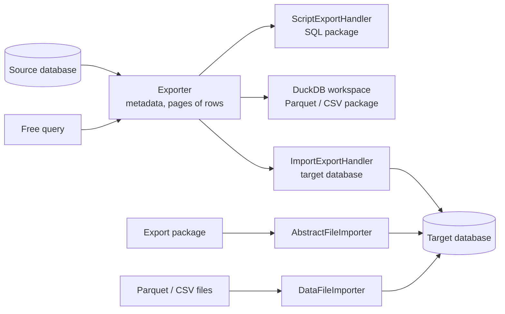
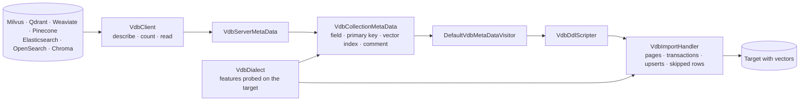

# SqlJam Developer Guide

**Use the engine of SqlJam from your own Java code.**

The desktop application is a thin layer over the `com.github.sqljam.impexp` API. Every export, import and copy that the UI runs is a few lines of Java: configure a source, pick an exit, call `export`. This guide shows those lines for each task.

---

## Contents

| Task | Classes |
|---|---|
| [Add SqlJam to a project](#add-sqljam-to-a-project) | Maven coordinates |
| [Core classes](#core-classes) | Overview of the API |
| [1. Export tables as a SQL package](#1-export-tables-as-a-sql-package) | `ScriptExporter` |
| [2. Export Parquet and CSV packages](#2-export-parquet-and-csv-packages) | `ParquetExporter`, `CsvExporter`, `CsvOptions` |
| [3. Copy tables into another database](#3-copy-tables-into-another-database) | `ImportExporter` |
| [4. Import an export package](#4-import-an-export-package) | `AbstractFileImporter` |
| [5. Load Parquet and CSV files of other tools](#5-load-parquet-and-csv-files-of-other-tools) | `ParquetImporter`, `CsvImporter` |
| [6. Export the rows of a query](#6-export-the-rows-of-a-query) | `ExportConfiguration.queries` |
| [7. Export part of a table](#7-export-part-of-a-table) | `TableQuery` |
| [8. Transactions and errors](#8-transactions-and-errors) | `ManualTransaction`, `SharedConnectionFactory` |
| [9. Update or skip existing rows](#9-update-or-skip-existing-rows) | `WriteMode` |
| [10. Progress, log and cancel](#10-progress-log-and-cancel) | `ExportListener` |
| [11. Older servers, names and copies](#11-older-servers-names-and-copies) | target version, `IdentifierCase`, `tableNamePattern` |
| [12. Import from vector databases](#12-import-from-vector-databases) | `VdbClient`, `VdbExporter`, `VdbQuery` |
| [Option reference](#option-reference) | `ExportConfiguration`, `ImportConfiguration` |
| [Adding a database](#adding-a-database) | `Dialect`, `MetaDataOperations`, `DbType` |
| [Adding a vector database](#adding-a-vector-database) | `VdbClient`, `VdbType`, `VdbDialect` |

---

## Add SqlJam to a project

SqlJam is built with Maven and Java 17. Install it into the local repository, then depend on it:

```bash
git clone https://github.com/paganini2008/sqljam.git
cd sqljam
mvn -DskipTests install
```

```xml
<dependency>
    <groupId>com.github.sqljam</groupId>
    <artifactId>sqljam</artifactId>
    <version>1.0.0-SNAPSHOT</version>
</dependency>
```

The JDBC drivers of MySQL, MariaDB, PostgreSQL, Oracle, SQL Server, Db2, H2, SQLite, Microsoft Access (UCanAccess), DuckDB and ClickHouse come with it.

---

## Core classes



| Class | Role |
|---|---|
| `Exporter.ExportConfiguration` | Source: database, catalogs, schemas, tables, queries and options |
| `ScriptExporter` | Writes a SQL package: `schema.sql`, data files, LOB files, `constraints.sql`, `manifest.json` |
| `ParquetExporter` / `CsvExporter` | Write Parquet or CSV packages through an embedded DuckDB |
| `ImportExporter` | Copies tables straight into another database |
| `AbstractFileImporter` | Imports any package: SQL, Parquet or CSV, chosen by its `manifest.json` |
| `ParquetImporter` / `CsvImporter` | Load files of other tools into a table |
| `ManualTransaction` | One transaction for a whole import, committed or rolled back by you |
| `ExportListener` | Progress, messages, errors and cancel |
| `Dialect` / `MetaDataOperations` | Everything special to one database, one subclass per database and version |
| `DatabaseFeature` | Features of a target detected on its connection before they are used, e.g. pgvector, HNSW indexes |
| `SyncScheduler` / `SyncEngine` | Sync tasks of the application: watermarks, upserts by key, attempts and reports, run by SqlJam or by `sqljam sync` |
| `VectorType` / `VectorIndex` | A vector column (elements, dimensions, dense or sparse) and a vector index (HNSW or IVF, distance, options) of any database |

---

## 1. Export tables as a SQL package

**Input:** tables `orders` and `customers` of the MySQL database `shop`.

```java
ScriptExporter exporter = new ScriptExporter(new File("export/shop"),
        DataFileStrategy.FILE_PER_TABLE, 10L * 1024 * 1024);
Exporter.ExportConfiguration source = exporter.getConfiguration();
source.setDbType(DbType.MYSQL);
source.setUrl("jdbc:mysql://localhost:3306/shop");
source.setUsername("app");
source.setPassword("secret");
source.setIncludedCatalogNames(new String[]{"shop"});
source.setIncludedTableNames(new String[]{"orders", "customers"});
source.setIdReused(true);

// Statements for PostgreSQL in the schema sales
exporter.setTargetDbType(DbType.POSTGRESQL);
exporter.setTargetSchemaName("sales");
exporter.exportDdlAndData();
```

**Output:**

```text
export/shop/
├── schema.sql          # tables, sequences, indexes, comments
├── orders.sql          # orders_2.sql, orders_3.sql … above 10 MB
├── customers.sql
├── lob/                # BLOB and CLOB values as files
├── lob-manifest.json
├── constraints.sql     # foreign keys, applied after the rows
└── manifest.json       # source, target, options, files with SHA-256, row counts
```

| Call | Effect |
|---|---|
| `exportDdlAndData()` | Structure and rows |
| `exportDdl()` | Structure only |
| `exportData()` | Rows only, into existing tables |
| `export(ExportMode.DDL_DATA)` | Same as the first, by `ExportMode` |
| `DataFileStrategy.SINGLE_FILE` | All rows in `data.sql`, `data_2.sql` … |
| `setLobSeparated(false)` | LOB values as literals inside the data files |

---

## 2. Export Parquet and CSV packages

```java
ParquetExporter parquet = new ParquetExporter(new File("export/parquet"));
configureSource(parquet.getConfiguration());     // like the SQL package
parquet.setCompression("ZSTD");                  // ZSTD, SNAPPY, GZIP, UNCOMPRESSED
parquet.setMaxFileSize(256L * 1024 * 1024);      // orders.parquet, orders_2.parquet …
parquet.exportDdlAndData();

CsvOptions options = new CsvOptions();
options.setDelimiter(";");
options.setEncoding(CsvOptions.UTF_8_BOM);       // opens in Excel
options.setNullString("\\N");
options.setDateFormat("%d.%m.%Y");

CsvExporter csv = new CsvExporter(new File("export/csv"));
configureSource(csv.getConfiguration());
csv.setOptions(options);
csv.setMaxFileSize(10L * 1024 * 1024);           // orders.csv, orders_2.csv …
csv.exportDdlAndData();
```

| `CsvOptions` | Default | Values |
|---|---|---|
| `delimiter` | `,` | Any text, e.g. `;`, `\|`, `\t` |
| `quote` | `"` | `"` or `'` |
| `nullString` | empty | Text of NULL, an empty string is written as `""` |
| `header` | `true` | Column names in the first row of each part |
| `encoding` | `UTF-8` | `UTF-8`, `UTF-8 (BOM)`, `GBK`, `GB18030`, `UTF-16`, `ISO-8859-1` |
| `dateFormat` | ISO | e.g. `%Y/%m/%d`, `%d.%m.%Y` |

The column types are kept in `manifest.json`, so an import of the package restores every value with its type.

---

## 3. Copy tables into another database

**Input:** the schema `public` of PostgreSQL. **Output:** the same tables, keys, indexes, sequences and rows in Oracle.

```java
ImportExporter copier = new ImportExporter();

Exporter.ExportConfiguration source = copier.getExportConfiguration();
source.setDbType(DbType.POSTGRESQL);
source.setUrl("jdbc:postgresql://localhost:5432/demo");
source.setUsername("app");
source.setPassword("secret");
source.setIncludedSchemaNames(new String[]{"public"});
source.setIdReused(true);

ImportExportHandler.ImportConfiguration target = copier.getImportConfiguration();
target.setDbType(DbType.ORACLE);
target.setUrl("jdbc:oracle:thin:@//localhost:1521/demo");
target.setUsername("app");
target.setPassword("secret");
target.setTargetSchemaName("APP");

copier.setTargetVersion(11, 2);                  // Oracle 11g: sequences and triggers
copier.exportDdlAndData();
```

Rows are read and written in pages of 5000 rows (`setPageSize`), tables with LOB columns in pages of 100 (`setLobPageSize`). Foreign keys are created after the rows, identity values and sequences continue after the copied rows.

Columns are renamed, typed or left out by `columnMappings` of the target. Keys, indexes, foreign keys and identity values follow the new names, the other columns are imported as they are:

```java
Map<String, ColumnMapping> orders = new HashMap<>();
orders.put("NOTE", new ColumnMapping("REMARK", "TEXT", false));   // another name and type
orders.put("SECRET", ColumnMapping.skip());                        // not imported
target.getColumnMappings().put("ORDERS", orders);
```

A database behind a bastion host is reached through an SSH tunnel: `SshUtils.open` forwards a local port to the host and port which the SSH server reaches, and the url uses the local end. The tunnel of an id is shared and opened again on the same port when it breaks.

```java
SshSettings ssh = new SshSettings();
ssh.setEnabled(true);
ssh.setHost("bastion.example.com");
ssh.setUsername("deploy");
ssh.setAuthentication(SshSettings.Authentication.KEY);
ssh.setPrivateKeyFile("~/.ssh/id_ed25519");
int port = SshUtils.open("pg-prod", ssh, "10.0.0.12", 5432);
source.setUrl("jdbc:postgresql://127.0.0.1:" + port + "/demo");
// ... copy, then
SshUtils.close("pg-prod");
```

---

## 4. Import an export package

The package decides the importer: SQL, Parquet or CSV.

```java
try (Connection connection = DriverManager.getConnection(
        "jdbc:sqlserver://localhost:1433;databaseName=demo;encrypt=false", "app", "secret")) {
    AbstractFileImporter importer = AbstractFileImporter.forDirectory(
            new File("export/shop"), connection, DbType.SQLSERVER);
    importer.setBatchSize(1000);                 // statements per batch of SQL packages
    importer.setStopOnError(true);
    importer.importDirectory(new File("export/shop"));
    System.out.println(importer.getExecutedCount() + " statements, "
            + importer.getLobCount() + " LOB values, " + importer.getFailedCount() + " failed");
}
```

`manifest.json` is checked first: the status of the export, the target database type and the SHA-256 of every file. Data files and their parts (`orders.sql`, `orders_2.sql` …) are read in order, LOB values are restored by primary key, foreign keys come last.

---

## 5. Load Parquet and CSV files of other tools

```java
try (Connection connection = DriverManager.getConnection("jdbc:h2:./warehouse", "sa", "")) {
    CsvImporter importer = new CsvImporter(connection, DbType.H2);
    CsvOptions options = new CsvOptions();
    options.setDelimiter(";");
    options.setEncoding("GBK");
    importer.setOptions(options);                // null detects the delimiter and the types
    long rows = importer.importFiles(List.of(new File("sales.csv"), new File("sales_2.csv")),
            "SALES", DataFileImporter.Mode.CREATE);
}
```

| `DataFileImporter.Mode` | Target table |
|---|---|
| `CREATE` | Dropped and created from the columns of the files |
| `APPEND` | Rows are inserted into the existing table |
| `UPSERT` | Rows of the same key are updated, the others inserted |
| `SKIP_EXISTING` | Rows of an existing key are kept, the others inserted |

`ParquetImporter` works the same way with `.parquet` files. Key columns are set by `setKeyColumns(List.of("id"))`, the primary key of the table is used otherwise.

---

## 6. Export the rows of a query

A query is exported like a table, through every exit. The SQL Query editor of the UI does exactly this.

```java
ImportExporter exporter = new ImportExporter();
Exporter.ExportConfiguration source = exporter.getExportConfiguration();
source.setDbType(DbType.MYSQL);
source.setUrl("jdbc:mysql://localhost:3306/shop");
source.setUsername("app");
source.setPassword("secret");
source.setIncludedCatalogNames(new String[]{"shop"});
source.getQueries().put("order_summary",
        "SELECT c.name, COUNT(o.id) AS orders, SUM(o.amount) AS amount"
        + " FROM customers c JOIN orders o ON o.customer_id = c.id GROUP BY c.name");

ImportExportHandler.ImportConfiguration target = exporter.getImportConfiguration();
target.setDbType(DbType.DUCKDB);
target.setUrl("jdbc:duckdb:./reports.duckdb");
exporter.exportDdlAndData();
```

| What happens | How |
|---|---|
| Columns of the new table | A column of a table gets the type of that column, an expression gets the type of the result set |
| Columns of the same name | Numbered: `id`, `id_2` |
| Rows | Read once by a cursor and written page by page, no OFFSET paging |
| Types a table export converts | Selected again by the same conversion, e.g. Oracle `XMLTYPE` and `VECTOR`, ClickHouse `Map` and `Tuple` |
| Other exits | Put the query into `ScriptExporter`, `ParquetExporter` or `CsvExporter` configurations the same way |

---

## 7. Export part of a table

```java
TableQuery query = new TableQuery(
        List.of("id", "name", "amount"),         // columns, all if empty
        "amount > 100 AND status = 'PAID'",      // WHERE
        null,                                    // GROUP BY is for viewing only
        "amount DESC");                          // ORDER BY
source.getTableQueries().put("orders", query);
```

Keys, indexes and foreign keys whose columns are all selected are kept. A missing target table is created with the selected columns.

---

## 8. Transactions and errors

**One transaction, all or nothing:** share one `ManualTransaction` with the importer.

```java
Connection connection = DriverManager.getConnection(url, user, password);
try (ManualTransaction transaction = new ManualTransaction(connection,
        DbType.POSTGRESQL.isTransactionalDdl())) {
    copier.setTargetConnectionFactory(new SharedConnectionFactory(transaction.getConnection()));
    copier.exportDdlAndData();
    if (transaction.isRolledBack()) {
        System.out.println("Rolled back because of an error");
    } else {
        List<String> failed = transaction.commit();   // deferred DDL after the commit
    }
}                                                 // close() rolls back what is not committed
```

| Choice | Setting | Behavior |
|---|---|---|
| One transaction | `ManualTransaction` | An error rolls back the whole import |
| Commit every N rows | `setPageSize(N)` without `ManualTransaction` | Each page is committed, rows before an error stay |
| Stop on the first error | `failFast = true` (default) | The import ends at the error |
| Skip rows with errors | `failFast = false` | A failed page is written row by row, each bad row is reported with its key and error, the others are kept |

Databases which commit DDL at once (MySQL, MariaDB, Oracle, H2) keep their created tables after a roll back, `ManualTransaction` runs keys and identity statements after the commit for them. For packages, `AbstractFileImporter` takes the connection of the transaction directly: `forDirectory(dir, transaction.getConnection(), dbType)`.

---

## 9. Update or skip existing rows

```java
source.setTableRecreated(false);                 // keep the target tables
source.setWriteMode(WriteMode.UPSERT);           // or SKIP_EXISTING
source.getKeyColumnNames().put("customers", List.of("email"));
```

| `WriteMode` | Existing key | New key |
|---|---|---|
| `INSERT` (default) | Inserted, a key error is reported | Inserted |
| `UPSERT` | Updated | Inserted |
| `SKIP_EXISTING` | Kept as it is | Inserted |

The key is the primary key of the table, or the chosen columns: columns of a unique index of the target table. Statements per database:

| Database | Upsert | Skip existing |
|---|---|---|
| PostgreSQL, SQLite, DuckDB | `ON CONFLICT … DO UPDATE` | `ON CONFLICT … DO NOTHING` |
| MySQL, MariaDB | `ON DUPLICATE KEY UPDATE` | `ON DUPLICATE KEY UPDATE` without changes |
| Oracle, SQL Server, Db2, Access | `MERGE … WHEN MATCHED … WHEN NOT MATCHED` | `MERGE … WHEN NOT MATCHED` |
| H2 | `MERGE INTO … KEY` | `MERGE … WHEN NOT MATCHED` |

Names of an existing target table are matched without case, `OrderId` of the source writes `orderid` of PostgreSQL or `ORDERID` of Oracle.

---

## 10. Progress, log and cancel

```java
copier.setExportListener(new ExportListener() {

    @Override
    public void onTableProgress(String catalog, String schema, String table, long rows, long total) {
        System.out.printf("%s: %d / %d%n", table, rows, total);
    }

    @Override
    public void onProgress(long processed, long total) {
        System.out.printf("%.0f%%%n", processed * 100.0 / Math.max(total, 1));
    }

    @Override
    public void onError(String message, Throwable e) {
        System.err.println(message);             // e.g. Skipped row of table 'orders' (id=42): …
    }

    @Override
    public boolean isCancelled() {
        return stopRequested.get();              // the export stops at the next page
    }
});
```

| Callback | When |
|---|---|
| `onStart` / `onEnd(successful)` | Before the first and after the last step |
| `onTableStart` / `onTableProgress` / `onTableEnd` | Per table, rows read so far, and the rows written at the end without the skipped rows |
| `onProgress(processed, total)` | Rows of all tables, bytes of a package import |
| `onMessage` | Steps such as `Reading metadata ...` |
| `onError` | Errors and skipped rows or statements |
| `onRowSkipped(catalog, schema, table, key, e)` | A row which was skipped, with its key and error |
| `onDdlExecuted(statement, successful)` | A statement of the structure, executed or failed, the migration report counts the objects by them |
| `isCancelled` | Asked before each page |

---

## 11. Older servers, names and copies

| Need | Setting |
|---|---|
| Statements for an older server | `setTargetVersion(11, 2)` on the exporter or copier, e.g. Oracle 11g, SQL Server 2008 (`10, 0`), PostgreSQL 9, MySQL 5.5 |
| Case of names | `setIdentifierCase(IdentifierCase.LOWER)`: `AUTO`, `KEEP`, `LOWER`, `UPPER` |
| A copy in the same schema | `target.setTableNamePattern("{table}_copy")`, keys and indexes get their own names |
| Only some objects | `setIndexIncluded`, `setForeignKeyIncluded`, `setCommentIncluded`, `setSequenceIncluded` |
| Identity values | `setIdReused(true)` copies them and continues sequences after them |

---

## 12. Import from vector databases

The vector databases are a line of their own in `com.github.sqljam.vdb`, next to the JDBC line of `impexp`. It reads by REST APIs (the HTTP client of the JDK and Jackson), copies what it needs instead of calling `impexp`, and writes only into targets with vectors. `impexp` never refers to it, and `sqljam.vdb.enabled=false` hides it in the UI.



```java
VdbSource source = new VdbSource(VdbType.MILVUS, "http://milvus-host:19530");
source.setUsername("root");
source.setPassword("secret");
try (VdbClient client = source.getType().createClient(source)) {
    VdbExportConfiguration configuration = new VdbExportConfiguration();
    configuration.setTargetSchema("public");
    configuration.addCollection("docs", "docs");
    configuration.setQuery(VdbQuery.all().where("lang = 'en' and n >= 6"));
    configuration.setWriteMode(VdbExportConfiguration.WriteMode.UPSERT);
    configuration.setErrorSkipped(true);
    VdbExportResult result = new VdbExporter(client, dataSource, configuration, new VdbExportListener() {
        @Override
        public void onRowSkipped(VdbExportResult.TableResult table, String key, Exception e) {
            System.out.println("Skipped " + key + ": " + e.getMessage());
        }
    }).export();
}
```

| Part | Mapping |
|---|---|
| Collection | A table, named as the collection with other characters than letters, digits and `_` as `_` |
| Id | Primary key, with the tenant of Weaviate or the namespace of Pinecone when there are several |
| Vectors | Vector columns of the target: dense, 16-bit, int8 and sparse as the target has them, others as text |
| Fields | A column of each top-level field, typed by the schema or by a scan of the payloads, and `payload` with the whole payload as JSON |
| Vector index | The kind (HNSW, IVF), distance and options of the collection when the target has them |
| `VdbQuery` | `where("n >= 6 and lang IN ('en', 'zh')")`, `setNativeFilter` in the language of the database, `setNearestField` with `setNearestVector` or `setNearestId`, `setLimit` |
| `VdbExportConfiguration` | `tableRecreated`, `writeMode` (`INSERT`, `UPSERT`), `vectorIndexCreated`, `commentCreated`, `pageSize`, `transactional`, `errorSkipped` |
| Fields of a collection | `getMappings().get(i).getFields().put("title", new VdbFieldMapping("headline", null, false))`, `VdbFieldMapping.skip()` leaves a field out, the id is always imported |
| `VdbExporter.getScripts()` | The statements of the tables, which are not executed |
| Levels and parts | `VdbClient.getDatabases()` of Milvus and Chroma (`VdbSource.withDatabase`), `listPartitions(collection)` for partitions of Milvus, tenants of Weaviate and namespaces of Pinecone, read apart by `VdbQuery.getPartitions()` |
| Information | `VdbClient.getOverview()` and `getHealth()`, sections of names and values as the Info page shows them |

---

## Option reference

`Exporter.ExportConfiguration` (source):

| Option | Default | Description |
|---|---|---|
| `dbType`, `url`, `username`, `password` | | Source database |
| `includedCatalogNames` / `includedSchemaNames` | all | Catalogs (MySQL databases) and schemas to read |
| `includedTableNames` / `includedTableNamePattern` | all | Tables by name or by regular expression |
| `queries` | | Free queries exported as tables, SQL by table name |
| `tableQueries` | | Columns, WHERE and ORDER BY per table |
| `tableRecreated` | `true` | Drop and create target tables |
| `idReused` | `false` | Copy identity values and continue sequences |
| `indexIncluded` / `foreignKeyIncluded` / `commentIncluded` / `sequenceIncluded` | `true` | Objects to copy |
| `failFast` | `true` | Stop on the first error, `false` skips rows with errors |
| `pageSize` / `lobPageSize` | `5000` / `100` | Rows per page, rows per page of tables with LOB columns |
| `writeMode` / `keyColumnNames` | `INSERT` | `UPSERT` or `SKIP_EXISTING` by key columns per table |
| `connectionPoolEnabled` | `true` | HikariCP pool for the source |

`ImportExportHandler.ImportConfiguration` (target of a copy):

| Option | Default | Description |
|---|---|---|
| `dbType`, `url`, `username`, `password` | | Target database |
| `targetCatalogName` / `targetSchemaName` | source names | Where the tables go |
| `targetSchemaCreated` | `true` | Create a missing schema (database of MySQL) |
| `tableNamePattern` | | Target table names, `{table}` is the source name |
| `columnMappings` | none | Target name, type written as it is, or no column, by source table and source column. Other columns are imported as they are |
| `connectionPoolEnabled` | `true` | HikariCP pool for the target |

---

## Adding a database

| Step | Where |
|---|---|
| Dialect: types, literals, DDL, paging, upserts | `impexp.db.XxxDialect extends Dialect` |
| Metadata: catalogs, schemas, tables, columns, keys | `impexp.db.XxxMetaDataOperations extends MetaDataOperations` |
| Older versions | `XxxNNDialect extends XxxDialect`, chosen by `Dialect.forVersion` |
| Versions other than the server version, e.g. the file format of Access | `Dialect.readDatabaseVersion` |
| Tables which are emptied before they are dropped, drops of missing tables | `Dialect.getEmptyTableStatement`, `Dialect.isMissingDropError` |
| Features which the version does not tell, detected by probes which do not fail | `Dialect.detectDatabaseFeatures`, `Dialect.hasDatabaseFeature(feature, byVersion)` |
| Vector columns and indexes of the source | `VectorType.DETAIL_KEY` of a column, `VectorIndex.DETAIL_KEY` of an index, set by `MetaDataOperations` |
| Vector types, values and indexes of the target | `Dialect.getVectorTypeName`, `Dialect.getVectorValue`, `Dialect.getCreateVectorIndexStatement` |
| Sessions of the target, e.g. the search path of extensions | `Dialect.prepareSession` |
| Registration | A constant of `DbType` with driver, URL template and category |
| Fixture and tests | `src/test/resources/<db>/fixture.sql`, a value of `ItDatabase`, the cross-database matrix runs it |

## Adding a vector database

| Step | Where |
|---|---|
| REST client: version, collections, describe, count, read pages | `vdb.client.XxxClient extends AbstractVdbClient` |
| Payloads without a schema | `PayloadSchema.observe` of a scan, then `getFields` |
| Vectors of other elements | `VdbValues` (dense, bytes, sparse, 16-bit floats) |
| Registration | A constant of `VdbType` with its default port, client, authentication (API key, user) and levels (databases, tenants, the name of its partitions) |
| Levels, information | `getDatabases`, `listPartitions`, `getOverview` and `getHealth` of the client when the database has them |
| Target databases | `vdb.dialect.XxxVdbDialect extends VdbDialect`, returned by `VdbDialect.of` |
| Fixture and tests | A value of `VdbServer` and its settings in `it-vdb-test.properties`, `VdbImportIT` imports it into every target |

Read the change logs in [change_logs](../change_logs) for the decisions behind each part.
